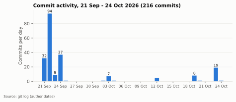
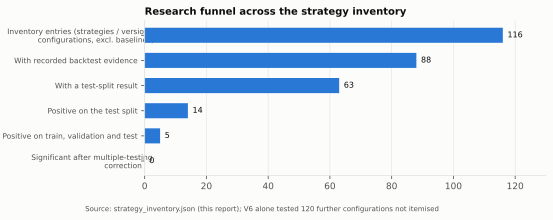
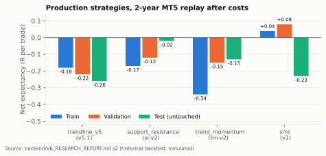
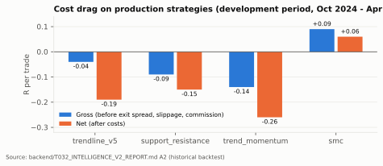
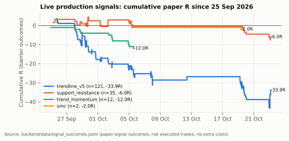
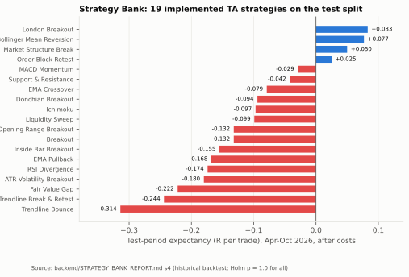
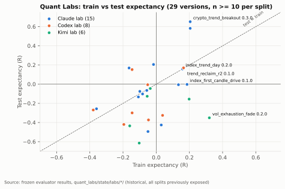
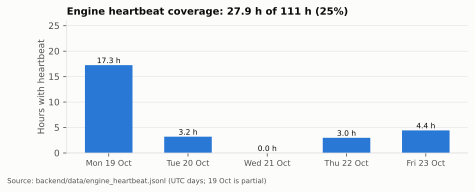

# TRADEDEN — The Complete Journey: Origins, Development, Research, Challenges and Future Vision

**Historical Review and Strategic Roadmap | October 2026**

Author / Project Founder: **Joseph Katumba**
Repository: `trading-hub` (TradeDen, formerly "Trading Hub") · Branch at review: `codex/tradeden-session-handoff` · HEAD `920676d` · Evidence cut-off: **2026-10-24**
Prepared by: Claude Code (claude-opus-5-5), working as a combined quant-research, architecture, audit, strategy, product, history and writing team, from repository evidence only.

<!-- pagebreak -->

## How to read this report

Every material statement carries one of four labels:

| Label | Meaning |
|---|---|
| [VERIFIED] | Read directly from a repository file, git history, a local data store or the running engine's own `/api/health` response during this review. The source is cited. |
| [RECONSTRUCTED] | A historical account assembled from several sources (commit messages, reports, docstrings) where no single record states it outright. Dates come from git author dates or from dates written inside files. |
| [ASSESSMENT] | The reviewers' judgement on 2026-10-24, based on the cited evidence. Reasonable people could weigh it differently. |
| [PROPOSAL] | A recommendation or plan. Nothing labelled PROPOSAL exists today. |

Other conventions:

- **R** is profit or loss per unit of planned risk (stop distance). "Expectancy" is mean net R per trade. Unless stated otherwise, historical R is **simulated** and **after estimated costs**.
- Evidence types are always named: **historical backtest** (replay on past MT5 data), **paper / live signal** (a signal generated in real time from live data, outcome measured on the market path, *no order placed*), **forward** (paper signals recorded prospectively after a strategy was frozen). **No executed-trade result exists anywhere in the repository.**
- Times are UTC unless marked EAT (UTC+3, the founder's working time zone).
- Charts use real repository data. The one funnel chart uses counts from the strategy inventory delivered with this report.
- No credentials, tokens, chat identifiers or account numbers appear in this report. Where a security problem involves a secret, only its existence is described.

<!-- toc -->

<!-- pagebreak -->

## Executive summary

**What TradeDen is today** [ASSESSMENT]. TradeDen is a single-founder, AI-assisted trading-intelligence platform built in about five weeks (first commit 2026-09-21, review 2026-10-24). It runs on one Windows laptop. A local FastAPI engine reads live MetaTrader 5 (MT5) data for 16 instruments every 30 seconds. It runs 4 production strategies, a 19-strategy "Strategy Bank" and 17 governed research models in paper mode, and it delivers signals and reports to Telegram. A Vite web app (the "Garden") visualises setups, lifecycle states and outcomes. A separate, hash-verified research laboratory (`quant_labs/`) lets three AI research agents (Claude, Codex and Kimi) register, evaluate and paper-trade strategies under one frozen evaluator.

**The engineering is good, and better governed than most solo trading projects** [ASSESSMENT]:

- closed-bar causality and look-ahead tests;
- an append-only evidence store with integrity recovery;
- executable-price qualification;
- a frozen, hash-pinned evaluator with train/validation/test splits;
- pre-registration of hypotheses in git before implementation;
- multiple-testing correction;
- explicit refusal to invent missing data.

The project's own reports repeatedly and correctly decline to claim profitability.

**No durable trading edge has been demonstrated** [VERIFIED]:

- **Production.** All four production strategies are negative after costs in a two-year MT5 replay. The main one, `trendline_v5`, does worse than every one of 20 random-entry controls (`backend/V6_RESEARCH_REPORT.md`).
- **Strategy Bank.** None of its 19 implemented strategies is better than zero after Holm–Bonferroni correction (`backend/STRATEGY_BANK_REPORT.md`).
- **Research.** About 157 pre-registered configurations went through V6/T-033, and about 30 hypotheses plus every Codex and Kimi family went through Quant Labs. None is statistically supported.
- **Best candidates.** The two "paper candidates", `index_trend_day` 0.2.0 (+0.147R, 225 trades, pooled) and `crypto_trend_breakout` 0.3.0 (+0.295R, 69 trades), are positive in every historical split. Neither is significant after correction, and every split had already been seen. Forward evidence for them is **zero signals** at the cut-off (`backend/data/quant_live/signals.sqlite3`).

**The most urgent finding is operational, not statistical** [VERIFIED]. On 2026-10-23 the engine's `/api/health` reported three Telegram channels as enabled and running:

- production signal alerts (`telegram_alerts.enabled: true`);
- Strategy Bank alerts (`strategy_bank.telegram_enabled: true`);
- daily and weekly reports.

From 2026-10-19 to 2026-10-23 the production notifier sent 37 trade-signal messages (28 `trendline_v5`, 8 support/resistance, 1 SMC) and 34 outcome follow-ups (5 targets, 29 stops). The bank sent 65 messages over the same period. Yet every internal research report from 2026-10-19 onward recommends that `trendline_v5` and Trend/Momentum alerts be paused or moved to shadow. The "Telegram is DRY_RUN" description in older handoffs is accurate only for the Quant Labs research categories. [ASSESSMENT] Users of this Telegram channel are receiving alerts from strategies the project's own evidence shows to lose money.

**Live paper outcomes agree with the backtests** [VERIFIED]. Across distinct production confirmations since 2026-09-25 (current strategy families, excluding the retired v3 backfill and shadow records), the authoritative resolver records 37 targets and 133 stops: **−53.8R over 170 resolved signals, −0.32R per signal**. The independent audit found real defects in that resolver, so the exact number is not clean. Its own conservative M1 re-resolution of the verifiable subset was −0.354R per signal (`audit_independent/CEO_AUDIT_REPORT.md`).

**Five most important discoveries**

1. **No edge, honestly established.** The project has built a credible machine for *rejecting* strategies. Its conclusion that the current signals have no edge is well supported. [ASSESSMENT]
2. **Production alerts contradict the research.** Losing strategies still alert to Telegram, while the only two paper candidates have produced no live signal. [VERIFIED]
3. **Costs, not ideas, decide the outcome.** Tight-stop M15 entries carry about 0.15R of cost per trade. Every family that stayed positive held positions for hours to days with wide stops and time exits (index trend days, crypto momentum). [VERIFIED; `T032_INTELLIGENCE_V2_REPORT.md`, `MILESTONE_3_PROFITABILITY_INVESTIGATION.md`]
4. **The binding constraint is data and time, not compute.** Only two years of M15/H1 history and about three months of M1 are available. At current signal frequencies a realistic +0.05–0.10R edge needs 12–50 months of trades to confirm (`V6_RESEARCH_REPORT.md`). [VERIFIED]
5. **Infrastructure is fragile where it matters most.** The 2.6 GB live store sits in an over-quota OneDrive folder that has already corrupted it once (2026-10-05). The engine was up about 25% of the time between 2026-10-19 and 2026-10-23. Research jobs fail on OneDrive file locks. [VERIFIED]

**Five most urgent recommendations** [PROPOSAL]

1. **Within 24 hours:** switch production `trendline_v5` and Trend/Momentum Telegram alerts to shadow, and relabel or pause the S/R, SMC and Strategy Bank alerts as "research, unproven". This is a CEO configuration decision; this review changed nothing.
2. **Move all runtime state out of OneDrive.** Apply the tested relocation tool and set `TRADING_HUB_DATA_DIR` to a local, backed-up path.
3. **Fix the outcome resolver's P1 defects** found by the independent audit: entry-minute skip, non-contiguous coverage, gap tolerance, and the confirmed-at versus entry-time mismatch. Then re-resolve history as auditable revisions.
4. **Stop adding strategies.** Freeze the research catalogue and let the two paper candidates accumulate about three months of forward evidence. In parallel, run the MT5 maintenance window to unlock the untouched 2022–2024 holdout.
5. **Rotate the Telegram bot token.** The repository's own T-031 report says the token was pasted into a chat. Then make engine uptime a tracked SLO, with the watchdog fixed so relaunches stop failing.

**Scores** [ASSESSMENT] (detail in Section 10):

| Area | Score / 10 |
|---|---|
| Overall | **5.0** |
| Engineering | 7.0 |
| Research methodology | 7.5 |
| Strategy performance | 1.5 |
| Data infrastructure | 4.5 |
| Reliability | 3.5 |
| Commercial readiness | 2.5 |
| Scalability | 3.5 |
| Long-term potential | 5.5 |

<!-- pagebreak -->

## 1. Scope, method and evidence base

### 1.1 What was examined

[VERIFIED] The review covered:

- **Git history:** 216 commits, 2026-09-21 to 2026-10-24.
- **Tracked files:** 1,038, plus the gitignored local stores, which were read only.
- **Top-level documents:** `README.md`, `ROADMAP.md`, `PROJECT_LOG.md`, `KIMI_SESSION_HANDOFF.md`, `TRADEDEN_OVERNIGHT_CEO_REPORT_2026-10-23.md`.
- **Founding documents:** `docs/product-plan.md`, `docs/data-model.md`, `docs/v0.1-ui.md`, `docs/V2_RECOVERY.md`.
- **Backend reports:** session A/B, timestamp audit, Trend/Momentum stop A/B, Strategy Upgrade Phase 1, T-031 Telegram, T-032 Intelligence V2, T-033 discovery, V6 research, the Strategy Bank report and the 2026-10-19 signal audit.
- **The independent audit:** `audit_independent/CEO_AUDIT_REPORT.md` and its machine-readable outputs.
- **Quant Labs:**
  - the four `quant_labs/CEO_*` reports, the Codex contributions audit, the integration, resilience, M5 and M1 runbooks;
  - every Claude lab report and milestone file;
  - `notes/RESEARCH_JOURNAL.md`, pre-registrations, audit JSON and results JSON;
  - the Kimi CEO report.
- **Registries and ledgers:**
  - `quant_labs/state/labs/{claude,codex,kimi}/{registry,experiments,performance}.jsonl` and `m5_*.jsonl`;
  - the SQLite job ledger `quant_labs/state/control.sqlite3`, opened read-only;
  - the live paper database `backend/data/quant_live/signals.sqlite3`, opened read-only.
- **Live stores (read-only):** `backend/data/signal_outcomes.jsonl`, `strategy_bank/signals.jsonl`, `telegram_notifications.jsonl` (counts only), `engine_heartbeat.jsonl`, `ops/watchdog.jsonl`, `research/registry.json` and `strategy_bank/expansion_results.json`.
- **The running engine:** one read-only call to `GET http://127.0.0.1:8000/api/health` at about 21:54 UTC on 2026-10-23.
- **Deployment material:** `deploy/*.md`, `deploy/*.ps1`, `deploy/Caddyfile*`, the `.env` example templates, and the names and on/off values of the `TRADEDEN_*_ENABLED` flags (never secret values).

Not examined: the "Company HQ" repository (referenced as a separate project), broker statements, and any external market or competitor data. Nothing was executed against MT5, Telegram or a broker. No production file was modified.

### 1.2 Earliest identifiable evidence

[VERIFIED] The earliest artefact is commit `425f932` "Initial commit" (2026-09-21 22:52 +03:00). It is followed within three minutes by `5c141a6` "Define Trading Hub product vision and roadmap" and by the three founding documents. No file, comment or data record dates from before 2026-09-21.

[RECONSTRUCTED] The founder may have traded or planned before that date. The "real MT5 trade sample" loaded on 2026-09-22 (`1ae1371`) implies existing MT5 trading activity. That pre-history is outside the repository and is recorded here as a gap.

### 1.3 Evidence inventory (summary)

| Evidence class | Key sources | Coverage | Reliability |
|---|---|---|---|
| Git history | 216 commits; branches `main`, `codex/commercial-mvp-phase1`, `codex/tradeden-session-handoff`, `phase1-foundation-fixes`, `tradeden-garden` | 2026-09-21 → 2026-10-24 | High for what was committed; large gaps where work stayed uncommitted for days (`PROJECT_LOG.md` says so) |
| Engineering reports | `backend/*_REPORT.md`, `quant_labs/*.md`, `quant_labs/state/labs/*/` | 2026-09-24 → 2026-10-23 | High; self-reported by AI sessions, but cross-checked against stores in this review |
| Independent audit | `audit_independent/` | snapshot 2026-10-19 | High; reproducible scripts and hashed inputs |
| Live signal stores | `backend/data/*.jsonl` (2.6 GB, gitignored) | 2026-09-22 → 2026-10-23 | Medium; 127 damaged lines quarantined, known resolver defects |
| Research ledgers | registries, `control.sqlite3`, results JSON | 2026-10-19 → 2026-10-23 | High; append-only, enforced by SQLite triggers |
| Engine telemetry | `/api/health`, heartbeat, watchdog log | 2026-10-19 → 2026-10-23 | Medium; heartbeat began only 2026-10-19 |
| Commercial | `deploy/COMMERCIAL_MVP.md`, `PRIVATE_BETA.md`, `READINESS.md`, `backend/commercial*.py` | 2026-10-12 | Code exists; never deployed |

The full register of files cited is in Appendix A. The machine-readable strategy inventory (`strategy_inventory.json` / `.csv`) accompanies this report.

<!-- pagebreak -->

## 2. The journey: timeline, milestones and development stages

### 2.1 Overview



[VERIFIED] Commits cluster on a few days: 94 on 2026-09-22, 37 on 2026-09-24 and 19 on 2026-10-23. Several multi-day gaps follow, for example 2026-09-25 → 10-02 and 10-04 → 10-12.

[RECONSTRUCTED] `PROJECT_LOG.md` states that substantial work happened in uncommitted form during those gaps: Phase 11, the Trendline v5 replacement, S/R episodes and the Garden command centre. Commit dates therefore understate how continuous the activity was. They also make precise dating of some features impossible. Where a report records its own date, that date is used.

[RECONSTRUCTED] The project went through five eras:

| Era | Dates | Theme | Defining question |
|---|---|---|---|
| I. Journal & dashboard | 21–23 Sep | A trader-owned analytics workspace | "How am I doing?" |
| II. Market Radar & scanner | 22–25 Sep | Live MT5 setup detection | "What is the market offering?" |
| III. Engine hardening & the Garden | 24 Sep – 12 Oct | Trustworthy data, a strategy platform, honest UI | "Can I trust what I see?" |
| IV. Signals, bank & commercial MVP | 12–20 Oct | Qualification, Telegram, 20 strategies, subscriptions | "Can this become a product?" |
| V. Governed research labs | 19–24 Oct | Frozen evaluator, three AI labs, pre-registration, paper candidates | "Does anything actually have an edge?" |

### 2.2 Milestone register

Each row gives the date, the feature, the motivation, the implementation, the outcome, the evidence and the impact. Dates are git author dates unless marked *(file)*.

| Date | Milestone | Motivation | Implementation | Outcome | Evidence | Impact | Label |
|---|---|---|---|---|---|---|---|
| 2026-09-21 | Product vision and V0.1 dashboard | Trading data is fragmented across brokers, prop firms and journals | Vite SPA; `docs/product-plan.md`, `data-model.md`, `v0.1-ui.md`; GitHub Pages workflow | Dark "command centre" dashboard on seeded data | `5c141a6`, `4e8791e`, `29b1611` | Set the original thesis: "the trading account becomes the journal; the data becomes the coach" | VERIFIED |
| 2026-09-21 | CSV trade import and analytics engine | Real trades instead of demo data | `ba037ea` parser; P&L, win rate, PF, drawdown | Working journal | `ba037ea`, `fbd8fa5`, `88420d9` | First real-data capability | VERIFIED |
| 2026-09-21/22 | Post-trade review, behavioural intelligence, "Ask Trading Hub" coach | Turn history into coaching | Rule-based behaviour engine and question engine | Coach UI on a real MT5 sample | `f2ac613`, `d9cc7f2`, `caa0b72`, `1ae1371` | The coach is rule-based, not ML; later relabelled honestly | VERIFIED |
| 2026-09-22 01:06 | MT5 market engine and Market Radar | Move from looking back to live opportunities | Python backend over the MT5 terminal; first trendline scanner | Live scanner connected to MT5 | `e071951`, `7fdac17`, `4b3a7bf` | Pivot from journal to signal intelligence | VERIFIED |
| 2026-09-22 | Transparent setup scoring, sessions, macro panel, buy/sell direction, calculated entry/stop/target | Explainable setups | Rule-point scoring; London/NY context; optional fundamentals provider | "Radar V2" and observatory cards | `51adbf1`, `712a3df`, `4913451`, `8d13fb7` | The score was later found to be uncalibrated (relabelled "rule pts" on 2026-10-12) | VERIFIED |
| 2026-09-22 17:42 | Trading Hub V3: trendline-first scanner and MT5 bridge (MQL5 EA) | Dependable MT5 data path | `mt5/TradingHub_Bridge.mq5` | Bridge documented; engine later used the Python MT5 API directly (bridge shows OFFLINE in health) | `a22e5bc`, `/api/health` | Bridge is now vestigial | VERIFIED |
| 2026-09-22 22:42 | Confirmation gate relaxed "without weakening trendline strategy" | Too few setups confirmed | Gate change | More confirmations | `6ebf1e3` | [ASSESSMENT] An early instance of tuning for signal count rather than evidence | VERIFIED / ASSESSMENT |
| 2026-09-23 | Analytics quality: expectancy, risk, data quality, confidence, consistency | Analytics on imported trades were overconfident | Quality and confidence layers | Risk/R shown as "Unavailable" when MT5 exports lack stops | `1d42835`…`a1682ed`, `a247241` | Start of the project's data-honesty culture | VERIFIED |
| 2026-09-24 | Phase 1 hardening: canonical port 8000, no account identifiers exposed, local-only engine, reused MT5 connection, idempotent import | Reliability and privacy | Small scoped commits | Engine safe to run locally | `0d7c608`, `f90b0fd`, `3568001`, `fc42759` | Security baseline | VERIFIED |
| 2026-09-24 11:39 | Indexed observation store | Re-scanning an 81 MB JSONL on every request | `jsonl_index.py` | Fast reads | `6571804` | Enabled scaling to the later 1.7 GB store | VERIFIED |
| 2026-09-24 | TRADeden Garden UI | Calm, honest visual metaphor for setup lifecycles | Three.js 3D and 2D fallback; lifecycle orbs; outcome archive | Garden becomes the landing page and the brand | `39cd695` → `08f78eb` | Product identity "TRADeden" | VERIFIED |
| 2026-09-24 | Strategy contract and registry; per-strategy persistence; Strategy Lab; 10-instrument universe | Run several strategies without contaminating evidence | `backend/strategies/`, `strategy_id` scoping | Multi-strategy platform | `b2d3a5b`, `921de55`, `a5bf06d`, `73c6ca1` | Foundation for everything later | VERIFIED |
| 2026-09-24 | Verified MT5 broker time basis; session A/B → trendline-first-v4 | Sessions were computed from broker server time, not UTC | `market_time.py`; basis `America/New_York+07:00` | Corrected session labels | `203bddd`, `884a3cf`, `c5e2948`, `SESSION_AB_REPORT.md` | Removed a systematic timestamp error | VERIFIED |
| 2026-09-24/25 | S/R and Trend/Momentum added in SHADOW, then three strategies LIVE | More setup types | Shadow → LIVE promotion | Trendline v4, S/R v1, T/M v1 live | `1099304`, `5e2ca8c`, `04c4b2a` | Promotion was based on implementation, not on evidence of edge | VERIFIED / ASSESSMENT |
| ~2026-09-25 *(file)* | Phase 11: T/M stop A/B → `tm-pullback-v2`; immutable confirmed plans | A displayed 1:79 R:R came from re-planning after confirmation | Immutable plans; evaluation layer | Plans can no longer drift | `TM_STOP_AB_REPORT.md`, `PROJECT_LOG.md` | Integrity improvement | RECONSTRUCTED |
| 2026-10-02 | Autonomous 30 s background scanning | Detect without the browser open | `autonomous_market_worker` | Engine scans unattended | `25b6c3c` | Made Telegram possible | VERIFIED |
| 2026-10-03 | Strategy Upgrade Phase 1: shared candle confirmation, S/R v2, Trendline v5.1 (adds retest), SMC v1 | v5 confirmed breaks on the break candle with no retest | `strategies/price_action.py` | 180-day replay: trendline BREAK setups 2,712 → 566 | `6d4b331`, `STRATEGY_UPGRADE_PHASE1_REPORT.md` | Fewer, cleaner setups; still unprofitable | VERIFIED |
| 2026-10-05 16:01Z *(file)* | **OneDrive corrupts the live store** | — | OneDrive sync-engine bytes written into `setup_observations.jsonl` at about 955 MB | 81 damaged lines plus 1 lifecycle line; readers stopped | `PROJECT_LOG.md` 2026-10-12 | First serious data-loss incident | VERIFIED (as reported) |
| 2026-10-12 | TRADEden V2: trade qualification at the live quote, lifecycle reclassification, verified outcomes, reconciled performance | 2 confirmations past the stop, 29 below 1.5R, 1 on a 38-hour-old tick | `qualification.py`, `test_tradeden_v2.py` | Executable R:R ≥ 1.5, quote ≤ 300 s | `71e0cff`, `PROJECT_LOG.md` | Major quality gate | VERIFIED |
| 2026-10-12 | Integrity recovery and launch readiness | Store damage; 2,165 duplicate outcome keys | Quarantine, clean projection, recovery tool | 127 lines quarantined byte-for-byte; nothing guessed | `fa651dc`, `deploy/READINESS.md` | Evidence-preservation discipline | VERIFIED |
| 2026-10-12 | Commercial MVP Phase 1 and private-beta preparation | Path to revenue | OIDC (Auth0-compatible), PostgreSQL migration, Free/Pro entitlements, inactive $19 billing hooks, TradingView embed, Lightweight Charts | Built and tested; **not deployed**; billing disabled | `8d7fba6`, `97c4520`, `deploy/COMMERCIAL_MVP.md` | Commercial scaffolding exists without a validated product | VERIFIED |
| 2026-10-19 | T-031 Telegram alerts **activated** for production signals | Deliver signals off-dashboard | `telegram_notifier.py`; dedup, retry, no replay | Live alerts ON from 2026-10-19 | `114ae91`, `efbbf5b`, `TELEGRAM_T031_REPORT.md` | First outward-facing output | VERIFIED |
| 2026-10-19 *(file)* | Signal audit; T-032 Intelligence V2; V6 research; T-033 discovery | Telegram users saw "16 confirmed, 8 stops, 0 targets" | Authoritative outcome resolver; 2-year replay lab; random-entry controls; Holm correction | All four production strategies lose after costs; 157 configurations, none significant | backend reports dated 2026-10-19 | The project's turning point: profitability disproven at current design | VERIFIED |
| 2026-10-19 | T-034/035/036 Strategy Bank (20 → unlimited), promotion gate, daily/weekly reports | Broaden the signal set | `backend/strategy_bank/`; promotion requires ≥ 60 forward signals, ≥ +0.05R, PF ≥ 1.10 and CEO approval | 19 working strategies, all unproven; 12 expansion configurations archived | `b793cd1`, `90bb095`, `b0bd3be`, `32bc50b` | [ASSESSMENT] Breadth was added after evidence showed no depth | VERIFIED |
| 2026-10-19 | Independent CEO audit | Verify dashboard losses and resolver | Isolated replay; 7 adversarial probes | 5 P1 resolver defects; current families −0.354R on the verifiable subset | `audit_independent/` | Critical, reproducible quality evidence | VERIFIED |
| 2026-10-20 *(file)* | Three independent Quant Labs and frozen evaluator `bbc0c08a…` | Prevent self-certification and evaluator drift | `quant_labs/`; SQLite triggers prevent updates or deletes | Codex, Claude and Kimi labs | `quant_labs/CEO_IMPLEMENTATION_REPORT.md` | Strongest research-governance asset | VERIFIED |
| 2026-10-20 | Claude lab: 8 versions; `index_trend_day` and `crypto_trend_breakout` survive | — | Lab harness equals the official queue | Two survivors; 13 rejected | `RESEARCH_JOURNAL.md`, `queue_runs/` | Only positive theme: momentum held to a time exit | VERIFIED |
| 2026-10-20 | OneDrive lock reproduced (2 of 770 renames fail in OneDrive, 0 of 778 locally); relocation tool built, not applied | Failed jobs | `maintenance/relocate_runtime.py` | Tool stopped safely; the two `runtime` folders were refused | `CEO_REPORT_INFRASTRUCTURE.md` | Root cause known, still unfixed | VERIFIED |
| 2026-10-23 | Kimi lab: 3 families × 2 versions; live paper integration | Independent hypotheses | Kimi Code session | All rejected | `a0fd9bf`, `kimi/notes/CEO_REPORT.md` | — | VERIFIED |
| 2026-10-23 | Quant Labs Telegram Category A approved for the 2 paper candidates; Monday-D1 staleness fix | — | Approval file `2026-10-23b_paper_candidates_only.json` | 0 genuine signals so far | `7afd025`, approvals | Correctly scoped delivery | VERIFIED |
| 2026-10-23 | Pre-registered hypotheses H1–H10 (failure-inverse, gold/BTC, crypto overnight) | Avoid post-hoc mining | Specs committed before code (`674ab1e`, `862075e`, `34bd776`, `bcce22a`) | All rejected or inconclusive; H10 kept internal | commits; `PHASE_3_STRATEGY_RESEARCH.md` | Methodological maturity | VERIFIED |
| 2026-10-23 | Gold/BTC explainable intelligence; Telegram Intelligence Center; watchdog installed | Value beyond signals | `backend/market_intel/`; scheduled task "TradeDen Engine Watchdog" | Briefings in preview; watchdog relaunches | `1a7a5b3`, `9c86fa6`, `0b62511` | First non-signal product capability | VERIFIED |
| 2026-10-23 | Codex paper integration, Codex audit, Kimi phase-2 screening; strategy sieve | Consolidation | — | 17 models live in paper | `5e7ec10`, `STRATEGY_SIEVE_2026-10-23.md` | — | VERIFIED |
| 2026-10-24 00:39 | Ignore the M5 runtime and ledger; keep relocation evidence archives | Hygiene | `.gitignore` | HEAD at review | `920676d` | — | VERIFIED |

### 2.3 Development stages derived from evidence

The brief listed candidate stages. Each is tested against the evidence below.

| Candidate stage | Exists? | Evidence | Label |
|---|---|---|---|
| Dashboard | Yes (V0.1 21 Sep; Garden 24 Sep; Markets 12 Oct) | `4e8791e`, `39cd695`, `deploy/COMMERCIAL_MVP.md` | VERIFIED |
| Technical-analysis strategies | Yes: trendline (22 Sep), S/R, T/M, SMC, and 16 bank TA strategies | `backend/strategies/`, `backend/strategy_bank/rules.py` | VERIFIED |
| Scanner | Yes; autonomous since 2 Oct | `7fdac17`, `25b6c3c` | VERIFIED |
| Confirmation | Yes; gate (22 Sep), shared candle confirmation (3 Oct), executable qualification (12 Oct) | `6ebf1e3`, `6d4b331`, `71e0cff` | VERIFIED |
| Multi-timeframe | Yes; MTF context 22 Sep, H4/D1 context 24 Sep, H4/H1/M15 strategies | `1883f32`, `73c6ca1` | VERIFIED |
| Backtesting | Yes, in several generations: `stop_ab.py` and replays (Sep), `research/lab` V6 (19 Oct), bank backtest, `research_autonomous`, frozen evaluator (20 Oct), M5 extension | reports | VERIFIED |
| Strategy bank | Yes (19 Oct) | `b793cd1` | VERIFIED |
| Automated quant experiments | Yes: T-033 discovery pipeline, Quant Labs queue and workers | `research/discovery.py`, `quant_labs/worker.py` | VERIFIED |
| Market intelligence | Yes: macro fundamentals panel (22 Sep, optional provider); gold/BTC intelligence (23 Oct) | `4913451`, `1a7a5b3` | VERIFIED |
| Telegram | Yes (19 Oct live; Quant Labs categories 23 Oct) | `114ae91`, `9c86fa6` | VERIFIED |
| Public dashboard | **Partly.** GitHub Pages deployment of the early static dashboard (21 Sep). The engine-backed product has never been publicly deployed. | `29b1611`, `deploy/PRIVATE_BETA.md` | VERIFIED |
| Subscriptions | **Code only.** Free/Pro entitlements and inactive $19 billing hooks. No payment provider is wired, no users. | `deploy/COMMERCIAL_MVP.md` | VERIFIED |
| AI-assisted R&D | Yes, and central: most reports are authored by Claude Code, Codex or Kimi sessions under "CEO directives" | report headers, `AGENTS.md` files | VERIFIED |

### 2.4 Key engineering decisions and their consequences

1. **Local-first engine on the founder's laptop, MT5 via the Python API** [VERIFIED].
   - *For:* zero hosting cost, direct broker data.
   - *Against:* uptime equals laptop uptime (about 25% measured, Section 6). Windows-only. One broker feed (IC Markets) with server-time quirks.
   - [ASSESSMENT] Right for prototyping, wrong for any service others depend on.
2. **Append-only JSONL stores with side indexes** (`jsonl_index.py`) [VERIFIED].
   - *For:* simple, auditable, never rewritten.
   - *Against:* the observations file is 1.7 GB, one process holds about 4 GiB in memory (`CEO_NEXT_PHASE_REPORT.md`), and there are no transactions. Corruption by OneDrive was possible.
   - [ASSESSMENT] Good for evidence, now outgrown.
3. **Strategies as registered, versioned classes scoped by `strategy_id`, with immutable confirmation plans** [VERIFIED]. This prevents evidence contamination across versions. It was one of the best early decisions.
4. **Closed-bar causality, verified broker time, executable-price qualification** [VERIFIED]. These eliminated look-ahead, session mislabelling and impossible fills. [ASSESSMENT] They are what makes the negative results trustworthy.
5. **"Honest UI" rules: no win rate shown without verified outcomes, scores relabelled "rule pts", demo mode labelled** [VERIFIED]. These are rare and valuable in retail trading software.
6. **Frozen, hash-pinned shared evaluator with lab isolation and append-only ledgers** [VERIFIED]. This removes the most common research failure, the researcher adjusting the measurement.
   - [ASSESSMENT] The isolation is application-level only, as the implementation report itself states. Same-account shells could bypass it.
7. **Promotion before evidence** [VERIFIED].
   - Strategies went LIVE on 2026-09-25 and Telegram went live on 2026-10-19, before any profitability test. The 2-year replay that showed losses came the same day as Telegram activation.
   - [ASSESSMENT] This ordering is the project's central strategic error.
8. **Breadth over depth after negative evidence** [VERIFIED]. After V6/T-032 showed no edge, the response was a 20-strategy bank, then an unlimited bank, then three labs and 17 paper models.
   - [ASSESSMENT] Every addition raised the multiple-testing bar and the maintenance load.
9. **AI agents as the development workforce under "CEO directives"** [VERIFIED].
   - *For:* very high throughput and unusually thorough documentation.
   - *Against:* fragmented ownership (Codex, Claude and Kimi each authored parts), long uncommitted periods, and reports that sometimes describe states that later changed. For example, "Telegram is DRY_RUN" was true for the labs but not for production.

<!-- pagebreak -->

## 3. Current architecture

### 3.1 System context

[VERIFIED from code, `/api/health` and reports.]

```
                         +--------------------------------------------------+
                         |          Founder's Windows laptop (single host)  |
                         |                                                  |
  IC Markets MT5   <---> |  MT5 terminal (1 of 7 installs; path not pinned) |
  (broker feed)          |        |  Python MetaTrader5 API (read-only)     |
                         |        v                                         |
                         |  FastAPI engine  127.0.0.1:8000  (engine 0.4.0)  |
                         |   |- autonomous scan worker (30 s, 16 symbols)   |
                         |   |- 4 production strategies (LIVE)              |
                         |   |- Strategy Bank worker (19 + 1 unsupported)   |
                         |   |- Quant Labs live consumer (17 models, paper) |
                         |   |- outcome resolver, reports scheduler         |
                         |   |- market_intel (gold/BTC, rule-based)         |
                         |   |- Telegram notifiers (3 channels)  ---------->|---> Telegram Bot API
                         |   '- JSONL + SQLite stores in OneDrive folder    |      (owner chat)
                         |        ^                                         |
                         |  Vite web app (localhost:5173): Garden, Markets, |
                         |  Strategy Lab, Strategy Bank, Quant Labs, Coach  |
                         |                                                  |
                         |  quant_labs/ control plane: frozen evaluator,    |
                         |  SQLite ledger, bounded workers (Job Objects)    |
                         |  Watchdog scheduled task (relaunch on port down) |
                         +--------------------------------------------------+
           (Company HQ: separate repository, reads /api/health and records; paper only)
```

### 3.2 Component map

| Layer | Components (path) | State | Label |
|---|---|---|---|
| Frontend | `src/main.js`, `marketRadar.js`, `src/garden/*` (Garden, Priority Watch, Strategy Lab, Strategy Bank), `quantLabs.mjs`, journal / coach / import modules | Running locally; production builds pass | VERIFIED |
| API / engine | `backend/main.py` (FastAPI), `scanner.py`, `market_data.py`, `market_time.py`, `observations.py`, `outcomes.py`, `signal_outcomes.py`, `qualification.py`, `trade_planning.py`, `performance.py`, `strategy_lab.py`, `evaluation.py`, `reports.py` | Running (engine 0.4.0) | VERIFIED |
| Strategies | `backend/strategies/` (trendline v5.1, S/R v2, T/M v2, SMC v1, `price_action.py`) | LIVE | VERIFIED |
| Strategy Bank | `backend/strategy_bank/` (`rules.py`, `indicators.py`, `engine.py`, `telegram.py`, `worker.py`, `qualification.py`, `expansion.py`) | Enabled, alerting | VERIFIED |
| Research (backend) | `backend/research/` (lab, V6, discovery, library, bank backtest) | Offline tools | VERIFIED |
| Quant Labs | `quant_labs/` (`control.py`, `queue.py`, `worker.py`, `frozen.py`, `evaluation/v1`, `m5/`, `maintenance/`, `dashboard/`) and `backend/quant_live/` (model host, consumer, delivery) | Live consumer enabled; queue run by operator | VERIFIED |
| Intelligence | `backend/market_intel/` | Preview generation on | VERIFIED |
| Commercial | `backend/commercial.py`, `commercial_store.py`, `migrations/`, `deploy/Caddyfile.commercial`, `commercial.env.example` | Code only; not deployed | VERIFIED |
| Ops | `deploy/*.ps1` (supervise, health check, backup, task registration), watchdog, `backend/ops` | Watchdog installed; supervision scripts unused | VERIFIED |
| MT5 bridge | `mt5/TradingHub_Bridge.mq5` | OFFLINE (health) | VERIFIED |

### 3.3 Data flow: from market data to an observation, a signal or a rejection

```
MT5 bars (M1/M15/H1/H4/D1, bid OHLC + spread + tick volume)
   |  fetch; drop forming bar; convert broker time -> UTC (basis America/New_York+07:00)
   v
Normalised candle context  ----(stale / missing / short history)----> REJECTED INPUT (logged, fails closed)
   |
   v
Strategy detect()  ---- no pattern ----> no record (evaluation counted)
   |  pattern found
   v
OBSERVATION  (setup_observations.jsonl; lifecycle DETECTED -> DEVELOPING -> CONFIRMING)
   |  strategy's own confirmation rule
   v
Qualification at live quote:  levels valid & ordered | price not past SL/TP | quote <= 300 s old |
                              executable R:R >= 1.5 (spread paid) | tick-size rounding
   |-- fails --> strategy_signal_valid kept, NOT confirmed (rule_evidence.qualification)
   v
CONFIRMED SIGNAL  (immutable plan; setup_confirmations.jsonl)
   |--> Telegram notifier (if LIVE + qualified + < 10 min old)
   v
Outcome resolver: first barrier on M15 with M1 tie-break, 7-day window ->
   TARGET_HIT / STOP_HIT / NO_HIT / AMBIGUOUS / UNAVAILABLE  (append-only revisions)
   v
Performance, Strategy Lab, Garden archive, daily/weekly Telegram reports
```

The Strategy Bank and the Quant Labs consumer use the same candle supply with their own gates:

- **Bank:** entry drift ≤ 0.5 ATR, spread ≤ 25% of risk, per-strategy minimum R:R, opportunity merge within 4 h.
- **Quant Labs:** minimum 2.0 net planned R:R, spread/risk ≤ 0.1, Monday-aware staleness.

### 3.4 Signal lifecycle

```
DETECTED -> DEVELOPING -> CONFIRMING -> CONFIRMED -> ACTIVE -> RESOLVED (TP | SL)
     \            \             \                        \-> NO_HIT (window ends) / AMBIGUOUS / UNAVAILABLE
      \            \             '-> INVALIDATED (price crossed invalidation before confirmation)
       '------------'-> EXPIRED (inactivity, replaced, or SIGNAL_WITHDRAWN since 12 Oct)
Quant Labs paper signals: DETECTED -> CONFIRMED -> ACTIVE -> TP_HIT | SL_HIT | TIME_EXIT | UNRESOLVED | DATA_CONFLICT
```

[VERIFIED] Before 2026-10-12, about 2,250 withdrawn setups were mislabelled INVALIDATED. They are now read as EXPIRED at read time. Stored records are never rewritten (`PROJECT_LOG.md`).

### 3.5 Strategy evaluation pipeline (the three generations)

```
Gen 1 (Sep):  replay tools (stop_ab.py, shadow_report.py) -> detection counts, no costs
Gen 2 (19 Oct): backend/research lab -> production classes replayed bar-by-bar, spread/commission/
                slippage/financing, train/val/test, random-entry twins, Holm-Bonferroni
                + discovery.py registry (DISCOVERED -> ... -> PRODUCTION_CANDIDATE, test scored once)
Gen 3 (20 Oct): quant_labs frozen evaluator bbc0c08a... (hash-verified), dataset bf130602...,
                lab submits intents -> trusted operator run-one -> append-only results
                -> leaderboard (historical / forward never pooled) -> CEO approval file -> live paper
                -> Telegram Category A only with approval + flag
```

### 3.6 Telegram delivery

```
                 +-- production notifier (setup_confirmations) --- LIVE since 2026-10-19
engine threads --+-- Strategy Bank telegram (bank opportunities) -- LIVE (flag on)
                 +-- reports scheduler (daily 23:00 EAT, Fri weekly) -- LIVE
                 +-- quant_live delivery: Cat A (2 paper candidates) -- APPROVED, 0 sent
                 |                       Cat B (research observations) -- PREVIEW only
                 |                       Cat C (gold/BTC briefings) ---- PREVIEW only
                 v
   shared pacing (~1 msg/s) -> Bot API -> retries (429 retry_after, 5xx backoff <= 8 tries)
   persistent dedup keys (signal:<id>, outcome:<id>) ; baseline-on-activation ; expire after 30 min
```

### 3.7 Deployment views

**Implemented** [VERIFIED]:

- `START TRADING HUB.bat` and `STOP TRADING HUB.bat` start and stop the engine (loopback 8000) and the Vite dev server (5173).
- The watchdog is installed as the scheduled task "TradeDen Engine Watchdog".
- An early static dashboard was published via GitHub Pages.

**Prepared, not executed** [VERIFIED]:

- **Private beta / commercial:** a Windows VM recommended at 2 vCPU / 8 GB / 80 GB, measured on the laptop and not soak-tested.
- **Edge:** a Caddy reverse proxy with TLS, same-origin frontend and API.
- **Accounts:** an Auth0-compatible OIDC tenant and PostgreSQL for users, journals and entitlements.
- **Operations:** process supervision, backup and restore scripts.

No host was purchased, and DNS, TLS, OIDC and PostgreSQL are unverified (`deploy/PRIVATE_BETA.md`, `READINESS.md`).

### 3.8 Implemented versus planned

| Capability | Implemented | Planned / not done |
|---|---|---|
| Live MT5 scanning, 16 instruments | Yes | Second broker/feed, tick data |
| Production strategies | 4 LIVE | Demotion of losing ones (recommended, not done) |
| Strategy Bank | 19 scanning and alerting | Forward-evidence promotion (no strategy promoted) |
| Quant Labs | 3 labs, frozen evaluator v1, M5 extension, 17 paper models | Separate OS identities or containers per lab; independent review of results |
| Outcomes | Authoritative resolver, 7-day window | P1 fixes from independent audit; tick-level resolution |
| Telegram | Production, bank and reports live; Cat A approved | Cat B/C outbound; send-time authorisation recheck (audit) |
| Market intelligence | Gold/BTC, rule-based, preview | Macro calendar, yields, crypto derivatives data |
| Commercial | OIDC, entitlements, migrations, tier plan | Billing provider, hosting, users, legal |
| Execution | **None by design** | "Not planned" (`ROADMAP.md`) |
| Runtime outside OneDrive | Tool built and tested | Not applied |
| Deeper history | M1 runbook prepared | MaxBars raise and refresh not run |

### 3.9 Single points of failure, security weaknesses and scalability limits [ASSESSMENT, grounded in VERIFIED facts]

**Single points of failure**

- **One laptop.** Engine, MT5, stores, labs and notifier share one machine and one Windows account. Measured heartbeat coverage was 27.6 h of 111 h (25%) between 2026-10-19 and 2026-10-23.
- **One MT5 terminal and broker feed** (IC Markets). `TRADING_HUB_MT5_TERMINAL_PATH` is not set, with 7 MT5 installs present (overnight report).
- **The OneDrive-hosted 2.6 GB data directory.** It has a corruption history, is in an over-quota folder, and causes file-lock failures.
- **One process holds all state.** About 4.3 GiB working set was measured on 2026-10-20.
- **The watchdog.** It logged 13 relaunches and 155 "relaunch suppressed: hourly limit reached; manual attention needed" events on 2026-10-23 (`backend/data/ops/watchdog.jsonl`). Recovery therefore stalls without the founder.
- **Key-person risk.** One founder plus AI sessions. Knowledge lives in reports and commit messages.

**Security weaknesses**

- **Telegram token exposure.** The T-031 report records that the Telegram bot token was pasted into a chat and should be revoked. No evidence of rotation was found. [VERIFIED as reported; rotation status UNKNOWN]
- **Public repository.** The repository is described as public (`CEO_COMPREHENSIVE_REPORT_2026-10-23.md`), and 21 local commits are not yet pushed. The overnight repo audit found no secrets in tracked files. `backend/.env`, `backend/data/`, `quant_labs/state/owner/` and `control.sqlite3*` are gitignored (verified with `git check-ignore`). Large evidence archives (`.zip`) are tracked.
- **Lab isolation is application-level only.** Any same-account shell can bypass it, as the project's own report states.
- **Engine binding.** Loopback-only today. Exposing it requires the gateway/OIDC path, which is untested on a real tenant.
- **Telegram authorisation.** Bank alert rights are not rechecked at send time. EXPERIMENTAL specs alert regardless of an ARCHIVED status (independent audit, governance defect).
- **MT5 credentials.** These sit in the terminal's encrypted config, backed up locally only (correctly kept out of git).

**Scalability limits**

- **Compute is not the constraint.** About 1.4 ms per strategy per symbol per scan (T-036).
- **Memory and storage are.** A 4+ GiB process, a 1.7 GB observation log, a 235 MB index sidecar using nested JSON, and 692 MB of market outcomes.
- **Statistics are the hardest limit.** Every extra strategy raises the multiple-testing bar.
- **Multi-user service is unbuilt.** Per-user state and a shared engine for many users are not built beyond entitlements, and the MT5 dependency ties the server to Windows.

<!-- pagebreak -->

## 4. Every strategy ever built

### 4.1 Census

[VERIFIED] The accompanying `strategy_inventory.json` / `.csv` lists **117 entries**: strategies, versions and tested configurations, across five layers. One evaluation fixture and the always-long control baselines are included and flagged. V6 also tested about 120 grid configurations inside 14 families. Those appear only at family level (`backend/V6_RESEARCH_REPORT.md`) and are not itemised.

| Layer | Entries | Status breakdown |
|---|---|---|
| Production engine strategies (incl. retired versions) | 10 | LIVE (production engine, Telegram alerts ON): 4; SUPERSEDED: 3; RETIRED: 2; DEPRECATED: 1 |
| Strategy Bank (T-034) | 20 | EXPERIMENTAL (bank alerts ON): 16; LINKED (measures production strategy): 3; UNSUPPORTED: 1 |
| Backend research (V6/T-033 registry + T-036 expansion) | 41 | ARCHIVED: 37; DISCOVERED: 3; BACKTESTED: 1 |
| Codex H1 autonomous research | 5 | NOT_QUALIFIED: 5 |
| Quant Labs (Claude, Codex, Kimi; incl. M5, baselines, fixture) | 41 | REJECTED / ARCHIVED (preserved): 17; EXPERIMENTAL PAPER (internal monitoring): 15; SUPERSEDED (newer version in live paper): 6; PAPER CANDIDATE (experimental, alerts on): 2; INFRASTRUCTURE FIXTURE: 1 |

Total entries: **117** [VERIFIED, generated from `strategy_inventory.json`].



[VERIFIED] Five entries are positive on train, validation and test:

- `index_trend_day` 0.1.0 and 0.2.0, which produce identical trades;
- `crypto_trend_breakout` 0.2.0 and 0.3.0, which are not independent;
- Strategy Bank #9 Bollinger mean reversion.

That is **three independent ideas**. None survives multiple-testing correction.

### 4.2 Production strategies (the engine that alerts today)

**How to read the figures.**

- *Historical* rows are the two-year bar-by-bar replay of the **current production code** (V6/T-032 lab, 2024-10-15 → 2026-10-12). They include recorded spread, half-spread stop slippage and IC-Markets-Raw-style commission.
- *Live paper* rows are distinct confirmed signals from `backend/data/signal_outcomes.jsonl`, excluding shadow records. They are barrier outcomes: target = +planned R, stop = −1R, **no extra costs**, no executed orders.



| Strategy / version | Status (23 Oct) | Historical backtest (2-yr replay, after costs) | Live paper outcomes (barrier R) | Recommendation |
|---|---|---|---|---|
| `trendline_scanner_v1_v2` pre-v3 | DEPRECATED | – | – | Historical only. No version-tagged outcome records found for these iterations. |
| `trendline` trendline-first-v3 | RETIRED | – | 252 sig / 230 res, +29.3R | Never merge with v5. Independent audit: 231 signals, +0.085R/signal conditional… |
| `trendline` trendline-first-v4 | RETIRED | – | 1 sig / 1 res, -1.0R | Historical only. |
| `trendline_v5` trendline-first-v5 | SUPERSEDED | – | 63 sig / 63 res, -20.2R | Do not revive. |
| `trendline_v5` trendline-first-v5.1 | LIVE (production engine, Telegram alerts ON) | -0.19R dev (n=6,665, WR 24%, PF 0.77); test -0.26R (n=2,501); x2 cost -0.35R | 58 sig / 58 res, -13.7R | SUSPEND alerts / move to SHADOW (recommended by V6, T-032, T-034 and the indepe… |
| `support_resistance` sr-levels-v1 | SUPERSEDED | – | 21 sig / 21 res, +2.9R | Most credible production family per independent audit (+0.316R on 17 independen… |
| `support_resistance` sr-levels-v2 | LIVE (production engine, Telegram alerts ON) | -0.15R dev (n=522, WR 28%, PF 0.80); test -0.02R (n=175); x2 cost -0.26R | 14 sig / 14 res, -8.9R | Relabel as 'research signal, unproven' or pause alerts; keep in controlled obse… |
| `trend_momentum` tm-pullback-v1 | SUPERSEDED | – | 1 sig / 1 res, -1.0R | Historical only. |
| `trend_momentum` tm-pullback-v2 | LIVE (production engine, Telegram alerts ON) | -0.26R dev (n=76, WR 28%, PF 0.65); test -0.13R (n=28); x2 cost -0.34R | 12 sig / 11 res, -11.0R | SUSPEND alerts / SHADOW (V6 and audit recommendation). |
| `smc` smc-confluence-v1 | LIVE (production engine, Telegram alerts ON) | +0.06R dev (n=133, WR 36%, PF 1.08); test -0.23R (n=51); x2 cost +0.01R | 2 sig / 2 res, -2.0R | Label research-only; failed on untouched test (V6). |

Sources: `V6_RESEARCH_REPORT.md` §2, `T032_INTELLIGENCE_V2_REPORT.md` A2, `backend/data/signal_outcomes.jsonl`, `/api/health`. [VERIFIED; recommendation = ASSESSMENT]





**Per-strategy notes**

**Trendline v5.1** (`trendline_v5`, M15 entries, H1 targets) [VERIFIED].
- *Hypothesis:* a validated trendline break followed by a rejected retest within 12 bars (0.15 ATR tolerance) continues to an H1 structural target. The bounce variant (REVERSAL) is unchanged from v5.
- *Rules:*
  - stop structural, about 1 M15 ATR;
  - executable R:R ≥ 1.5 since 2026-10-12.
- *Historical:*
  - −0.19R/trade over 6,665 development trades, with a 24% win rate and PF 0.77;
  - 0 of 6 walk-forward folds positive;
  - −0.26R on the 2,501-trade holdout;
  - −0.35R at doubled costs;
  - about 390 trades/month;
  - development drawdown 1,292R.
- *Gross of costs:* −0.04R, statistically indistinguishable from random. It is worse than all 20 random-entry twins and negative in all nine regimes.
- *Live:*
  - v5: 63 signals, 13 TP / 50 SL, −20.2R;
  - v5.1: 58 signals, 13 TP / 45 SL, −13.7R.
- *Weaknesses:* no predictive content in the entries, and stops so tight that costs alone produce the loss.

[ASSESSMENT] *Recommendation:* **retire from alerting immediately.** Keep it in shadow for reproducibility.

**Support & Resistance v2** (`sr-levels-v2`) [VERIFIED].
- *Hypothesis:* rejection from multi-timeframe levels with ≥ 3 reactions, now requiring a candle pattern, reverts to the next zone.
- *Historical:* −0.15R over 522 development trades; −0.02R on the 175-trade holdout; −0.26R at doubled costs.
- *Live:*
  - v1: 21 signals, +2.9R. The independent audit's conservative M1 re-resolution gave +0.316R on 17 trades.
  - v2: 14 signals, 2 TP / 12 SL, −8.9R.

[ASSESSMENT] The family with the least negative evidence, but the v1 → v2 change has not helped so far. *Recommendation:* research label or shadow. Do not pool v1 with v2.

**Trend/Momentum v2** (`tm-pullback-v2`) [VERIFIED].
- *Historical:* −0.26R over 76 development trades.
- *Live:* 12 signals, **0 targets ever** among live records. Targets sat 2.6–6.1R away, beyond the measurement horizon (`SIGNAL_AUDIT_2026-10-19.md`).

[ASSESSMENT] Target geometry is mismatched to the horizon. *Recommendation:* suspend alerts and redesign the target/horizon before any further test.

**SMC Confluence v1** (`smc-confluence-v1`) [VERIFIED].
- *Historical:* +0.06R over 133 development trades, CI −0.20 to +0.32. It failed the untouched test at −0.23R (n = 51).
- *Live:* 2 signals, 2 stops.
- It is also consumed by the Company HQ paper desk P04 (outside this repository).

[ASSESSMENT] *Recommendation:* research label only.

**Retired lines** [VERIFIED].
- **Trendline v3 backfill** (252 records dated 22–24 Sep: 88 TP / 142 SL / 22 unavailable, +29.3R). This was a one-off backfill, not live evidence. The independent audit calls it "retired; never merge with v5".
- **Trendline v4:** 1 live outcome.
- **Trend/Momentum v1:** 1 live and 1 shadow outcome.

### 4.3 The Strategy Bank (T-034 → T-036)

[VERIFIED] Twenty specified strategies:

- 3 are linked to production;
- 16 are independent experimental scanners;
- 1, VWAP, is **unsupported** because MT5 CFDs carry only tick volume. Declining to fake it was the right call.

Each strategy has written entry, stop, target and invalidation rules (`rules.SPECS`). The bank has:

- a causality test that catches an injected one-bar leak;
- common gates: completed candle, freshness, entry drift, valid levels, spread ≤ 25% of risk, minimum R:R, de-duplication, opportunity merge.

The historical test covers two years with chronological splits, realistic costs and financing, and Holm–Bonferroni correction across 19 strategies. The figures below are the bank report's own (secondary evidence, not rerun in this review).



| Strategy | TF | Trades | Win | Exp R | Train | Val | Test | x2 cost | Fwd paper sig / R | Status |
|---|---|---|---|---|---|---|---|---|---|---|
| Trendline Break & Retest | M15 | 2,153 | 25% | -0.203 | -0.139 | -0.270 | -0.244 | -0.371 | – | LINKED (measures production strategy) |
| Trendline Bounce | M15 | 8,076 | 24% | -0.232 | -0.186 | -0.228 | -0.314 | -0.435 | – | LINKED (measures production strategy) |
| Support & Resistance (linked) | M15 | 697 | 30% | -0.130 | -0.176 | -0.130 | -0.042 | -0.253 | – | LINKED (measures production strategy) |
| Breakout Trading | H1 | 1,882 | 34% | -0.053 | -0.040 | +0.003 | -0.132 | -0.126 | 6 / -6.0R | EXPERIMENTAL |
| EMA Crossover | H1 | 2,327 | 32% | -0.097 | -0.110 | -0.091 | -0.079 | -0.183 | 8 / -5.0R | EXPERIMENTAL |
| EMA Pullback | H1 | 5,293 | 32% | -0.103 | -0.095 | -0.054 | -0.168 | -0.178 | 16 / +2.0R | EXPERIMENTAL |
| RSI Divergence | H1 | 895 | 33% | -0.062 | -0.055 | +0.034 | -0.174 | -0.132 | – | EXPERIMENTAL |
| MACD Momentum | H1 | 4,318 | 34% | -0.033 | -0.048 | -0.009 | -0.029 | -0.097 | 10 / -4.0R | EXPERIMENTAL |
| Bollinger Band Mean Reversion | H1 | 774 | 56% | +0.032 | +0.009 | +0.029 | +0.077 | -0.024 | 1 / +0.7R | EXPERIMENTAL |
| Donchian Channel Breakout | H1 | 6,745 | 33% | -0.051 | -0.043 | -0.021 | -0.094 | -0.111 | 22 / -10.0R | EXPERIMENTAL |
| London Session Breakout | M15 | 4,198 | 42% | +0.004 | +0.042 | -0.150 | +0.083 | -0.031 | 3 / -1.9R | EXPERIMENTAL |
| Opening Range Breakout | M15 | 1,341 | 47% | +0.003 | +0.035 | +0.100 | -0.132 | -0.011 | 2 / -1.7R | EXPERIMENTAL |
| VWAP Reversion | - | – | – | – | – | – | – | – | – | UNSUPPORTED |
| Liquidity Sweep | H1 | 2,873 | 32% | -0.078 | -0.047 | -0.114 | -0.099 | -0.153 | 8 / -5.0R | EXPERIMENTAL |
| Fair Value Gap | H1 | 876 | 34% | -0.024 | +0.062 | -0.014 | -0.222 | -0.074 | 5 / +1.0R | EXPERIMENTAL |
| Order Block Retest | H1 | 717 | 35% | -0.002 | -0.087 | +0.164 | +0.025 | -0.086 | – | EXPERIMENTAL |
| Market Structure Break | H1 | 1,425 | 36% | +0.008 | -0.022 | +0.022 | +0.050 | -0.052 | 3 / -1.0R | EXPERIMENTAL |
| Inside Bar Breakout | H1 | 5,717 | 32% | -0.100 | -0.090 | -0.059 | -0.155 | -0.183 | 5 / -2.0R | EXPERIMENTAL |
| ATR Volatility Breakout | H1 | 5,816 | 33% | -0.069 | -0.045 | +0.003 | -0.180 | -0.135 | 14 / -11.0R | EXPERIMENTAL |
| Ichimoku Trend Following | H1 | 5,050 | 33% | -0.075 | -0.079 | -0.037 | -0.097 | -0.149 | 11 / -5.0R | EXPERIMENTAL |

Historical columns: `STRATEGY_BANK_REPORT.md` §4 (2-yr backtest, Holm p = 1.0 for every strategy). Forward column: `strategy_bank/signals.jsonl`, 19–23 Oct 2026, hypothetical barrier R. Linked #1–3 forward records are counted under production. [VERIFIED]

[VERIFIED] **Bank forward paper record** (`backend/data/strategy_bank/signals.jsonl`, 2026-10-19 → 2026-10-23, hypothetical barrier R):

- 114 signals: 21 TP, 88 SL, 3 time exits, 2 pending;
- **net −48.8R**;
- Telegram messages sent: 65 (3 expired).

The T-036 expansion tested 6 more literature-based families in 12 pre-registered configurations: FX session momentum, weekend gap fade, Turtle Soup, Heikin-Ashi, KAMA and prior-close reversion. **All were archived.** Prior-close reversion looked strong in training (+0.30R, n = 171) and lost on validation (−0.08R), a textbook overfitting signature.

[ASSESSMENT] The bank shows good engineering applied to a strategy set with no evidence of edge. It sends real alerts from strategies its own report labels "Unprofitable". *Recommendation:* keep the scanner, stop bank Telegram alerts, and admit strategies only through the existing promotion gate. That gate needs ≥ 60 forward signals, ≥ +0.05R, PF ≥ 1.10 and CEO approval, and should gain an uncertainty bound.

### 4.4 Backend research programmes (V6, T-033 discovery, Codex H1)

[VERIFIED]

- **V6** (2026-10-19): 120 configurations in 14 families, plus a regime-aware hybrid and instrument selection. No candidate is distinguishable from zero after Holm (best adjusted p ≈ 0.83).
- **T-033:** 29 catalogued methodologies with academic and practitioner sources:
  - 23 tested;
  - 5 rejected at intake for missing data (order book, COT, swap history, event calendar, multi-leg infrastructure);
  - 1 deprioritised as a published anomaly that later disappeared.
  - Across V6 and T-033, about 157 configurations went through train → validation; 7 reached the untouched test, each scored once. All Holm-adjusted p-values are 1.0.
- **Best candidate:** H1 Bollinger mean reversion in quiet regimes: test +0.068R, 193 trades, 95% CI −0.08 to +0.20. Status BACKTESTED, "promising, not proven".
- **Codex's earlier H1 autonomous research** (`research_autonomous/`): 5 hypotheses (Drift48, Robust Revert, Compression Release, Shock Fade, Relative Lag) over 80 instrument cases. Every supported case is NOT_QUALIFIED, and test expectancies run from −0.087R to −0.195R.

| ID | Family | Programme | Train R | Val R | Test R | Status | Note |
|---|---|---|---|---|---|---|---|
| `fx_session_momentum_k1.5` | fx session momentum | Strategy Bank expansion | -0.072 | – | – | ARCHIVED | Verdict: REJECTED ON TRAIN |
| `fx_session_momentum_k3.0` | fx session momentum | Strategy Bank expansion | -0.029 | – | – | ARCHIVED | Verdict: REJECTED ON TRAIN |
| `weekend_gap_k0.5` | weekend gap | Strategy Bank expansion | -0.060 | – | – | ARCHIVED | Verdict: REJECTED ON TRAIN |
| `weekend_gap_k1.0` | weekend gap | Strategy Bank expansion | -0.069 | – | – | ARCHIVED | Verdict: REJECTED ON TRAIN |
| `turtle_soup_n20` | turtle soup | Strategy Bank expansion | -0.041 | – | – | ARCHIVED | Verdict: REJECTED ON TRAIN |
| `turtle_soup_n55` | turtle soup | Strategy Bank expansion | -0.029 | – | – | ARCHIVED | Verdict: REJECTED ON TRAIN |
| `heikin_ashi_m3` | heikin ashi trend | Strategy Bank expansion | -0.125 | – | – | ARCHIVED | Verdict: REJECTED ON TRAIN |
| `heikin_ashi_m5` | heikin ashi trend | Strategy Bank expansion | -0.140 | – | – | ARCHIVED | Verdict: REJECTED ON TRAIN |
| `kama_er3` | kama trend | Strategy Bank expansion | -0.104 | – | – | ARCHIVED | Verdict: REJECTED ON TRAIN |
| `kama_er5` | kama trend | Strategy Bank expansion | -0.083 | – | – | ARCHIVED | Verdict: REJECTED ON TRAIN |
| `prior_close_reversion_k1.0` | prior close reversion | Strategy Bank expansion | +0.011 | -0.215 | – | ARCHIVED | Verdict: REJECTED ON VALIDATION |
| `prior_close_reversion_k1.5` | prior close reversion | Strategy Bank expansion | +0.296 | -0.080 | – | ARCHIVED | Verdict: REJECTED ON VALIDATION |
| `tsmom` | D1 time-series momentum (weekly) | Research discovery | – | +0.011 | -0.043 (n=352) | ARCHIVED | failed on test (V6 research, imported) |
| `trend_century` | trend_century | Research discovery | – | – | – | DISCOVERED | awaiting implementation |
| `xsmom_fx` | Cross-sectional momentum (weekly) | Research discovery | – | -0.006 | – | ARCHIVED | rejected on validation (V6 research, imported) |
| `ma_breakout_brock` | Donchian H1 trend breakout | Research discovery | – | – | – | ARCHIVED | rejected on train (V6 research, imported) |
| `turtle` | H4 Donchian + D1 trend | Research discovery | – | – | – | ARCHIVED | rejected on train (V6 research, imported) |
| `supertrend` | supertrend | Research discovery | – | – | – | ARCHIVED | rejected on train |
| `intraday_momentum` | intraday_momentum | Research discovery | – | -0.026 | – | ARCHIVED | rejected on validation |
| `bollinger_mr` | H1 Bollinger mean reversion | Research discovery | – | +0.067 | +0.068 (n=193) | BACKTESTED | best candidate; with overnight financing (T-033 cost model)… |
| `rsi2` | rsi2 | Research discovery | – | +0.068 | – | ARCHIVED | failed on test |
| `short_term_reversal` | short_term_reversal | Research discovery | – | – | – | DISCOVERED | awaiting implementation |
| `pairs` | pairs | Research discovery | – | – | – | ARCHIVED | infrastructure: multi-leg simulation |
| `orb` | London opening-range breakout | Research discovery | – | – | – | ARCHIVED | rejected on train (V6 research, imported) |
| `nr7` | nr7 | Research discovery | – | – | – | ARCHIVED | rejected on train |
| `williams_vb` | williams_vb | Research discovery | – | +0.098 | – | ARCHIVED | failed on test |
| `squeeze` | H1 volatility squeeze breakout | Research discovery | – | – | – | ARCHIVED | rejected on train (V6 research, imported) |
| `inside_bar` | H4 inside-bar breakout | Research discovery | – | +0.105 | -0.173 (n=272) | ARCHIVED | failed on test (V6 research, imported) |
| `fx_local_hours` | fx_local_hours | Research discovery | – | – | – | ARCHIVED | rejected on train |
| `turn_of_month` | turn_of_month | Research discovery | – | – | – | ARCHIVED | rejected on train |
| `overnight_drift` | overnight_drift | Research discovery | – | – | – | ARCHIVED | rejected on train |
| `weekend_effect` | weekend_effect | Research discovery | – | – | – | DISCOVERED | evidence of disappearance after publication |
| `pre_fomc` | pre_fomc | Research discovery | – | – | – | ARCHIVED | data unavailable: event_calendar |
| `fx_carry` | fx_carry | Research discovery | – | – | – | ARCHIVED | data unavailable: swap_history |
| `vsa_climax` | vsa_climax | Research discovery | – | -0.267 | – | ARCHIVED | rejected on validation |
| `order_flow` | order_flow | Research discovery | – | – | – | ARCHIVED | data unavailable: order_book |
| `cot` | cot | Research discovery | – | – | – | ARCHIVED | data unavailable: cot_history |
| `ml_logit` | ml_logit | Research discovery | – | – | – | ARCHIVED | rejected on validation |
| `regime_switch` | regime-aware hybrid | Research discovery | – | -0.011 | – | ARCHIVED | rejected on validation (V6 research, imported) |
| `smc_ict` | production SMC / SMC V2 | Research discovery | – | +0.083 | -0.231 (n=51) | ARCHIVED | failed on test (V6 research, imported) |
| `tv_repaint_warning` | tv_repaint_warning | Research discovery | – | – | – | ARCHIVED | methodology note, not a strategy |
| `drift48` | Drift48 (H1 normalized drift) | Codex autonomous research | – | – | -0.100 (n=303) | NOT_QUALIFIED | Archived; no live adapter. |
| `robust_revert` | Robust Revert (H1 median/MAD reversal) | Codex autonomous research | – | – | -0.195 (n=922) | NOT_QUALIFIED | Archived; no live adapter. |
| `compression_release` | Compression Release (H1) | Codex autonomous research | – | – | -0.129 (n=803) | NOT_QUALIFIED | Archived; no live adapter. |
| `shock_fade` | Shock Fade (H1) | Codex autonomous research | – | – | – | NOT_QUALIFIED | Archived; no live adapter. |
| `relative_lag` | Relative Lag (BTC/ETH residual fade) | Codex autonomous research | – | – | -0.087 (n=204) | NOT_QUALIFIED | Archived; no live adapter. |

Sources: `backend/data/research/registry.json`, `strategy_bank/expansion_results.json`, `CODEX_CONTRIBUTIONS_AUDIT_2026-10-23.md`. Empty cells = not reached (rejected earlier) or not recorded. [VERIFIED]

### 4.5 Quant Labs: Claude, Codex and Kimi (frozen evaluator `bbc0c08a…`)

**Protocol** [VERIFIED].
- *Dataset:* `bf130602…`: bid OHLC plus recorded spread for 16 symbols. M15/H1 run from August 2024; M1 has about 100,000 bars per symbol (July/August → 19 October 2026 only).
- *Splits:* train 2024-10-15 → 2025-10-01, validation → 2026-04-01, test → 2026-10-01. **All splits had already been seen by earlier research**, so none is a true holdout.
- *Costs:* bid/ask sides, commission, 0.25-spread adverse fills, 0.5-spread stop fills, swap modes 1/5; the stress case doubles them.
- *Gate:* the live qualification gate requires a net planned R:R ≥ 2.
- *Recording:* all failures are kept, and versions are immutable.

The table aggregates instrument-level queue jobs weighted by trade count. It reconciles with `STRATEGY_SIEVE_2026-10-23.md`.



| Lab | Strategy / version | TF | Instruments | Train R (n) | Val R (n) | Test R (n) | Test stress | Pooled R (n) | Status 24 Oct |
|---|---|---|---|---|---|---|---|---|---|
| claude | `index_trend_day` 0.1.0 | M15 | NAS100, US500, GER40 | +0.16 (103) | +0.12 (66) | +0.16 (56) | +0.15 | +0.147 (225) | SUPERSEDED (newer version in live paper) |
| claude | `crypto_trend_breakout` 0.1.0 | H4 | BTCUSD, ETHUSD | -0.22 (15) | -1.01 (3) | +2.97 (2) | +2.91 | -0.018 (20) | SUPERSEDED (newer version in live paper) |
| claude | `crypto_trend_breakout` 0.2.0 | H4 | BTCUSD, ETHUSD | +0.20 (40) | +0.37 (12) | +0.58 (16) | +0.53 | +0.323 (68) | SUPERSEDED (newer version in live paper) |
| claude | `hourly_shock_drift` 0.1.0 | H1 | EURUSD, GBPUSD, GBPJPY, USDJPY, A… | -0.10 (613) | -0.13 (316) | -0.07 (328) | -0.16 | -0.100 (1257) | EXPERIMENTAL PAPER (internal monitoring) |
| claude | `index_turn_of_month` 0.1.0 | M15 | NAS100, US500, GER40 | -0.02 (100) | +0.20 (56) | +0.21 (55) | +0.20 | +0.099 (211) | EXPERIMENTAL PAPER (internal monitoring) |
| claude | `index_gap_fade` 0.1.0 | M15 | NAS100, US500, GER40 | -0.05 (37) | +0.08 (17) | -0.49 (31) | -0.51 | -0.185 (85) | EXPERIMENTAL PAPER (internal monitoring) |
| claude | `crypto_trend_breakout` 0.3.0 | H4 | BTCUSD, ETHUSD | +0.20 (40) | +0.17 (14) | +0.65 (15) | +0.60 | +0.295 (69) | PAPER CANDIDATE (experimental, alerts on) |
| claude | `index_trend_day` 0.2.0 | M15 | NAS100, US500, GER40 | +0.16 (103) | +0.12 (66) | +0.16 (56) | +0.15 | +0.147 (225) | PAPER CANDIDATE (experimental, alerts on) |
| claude | `fvg_retest` 0.1.0 | M15 | XAUUSD, XAGUSD, EURUSD, GBPUSD, U… | -0.08 (1666) | -0.09 (812) | -0.10 (754) | -0.20 | -0.089 (3232) | REJECTED / ARCHIVED |
| claude | `pdhl_acceptance` 0.1.0 | M15 | XAUUSD, XAGUSD, EURUSD, GBPUSD, U… | +0.03 (56) | -0.26 (26) | -0.43 (36) | -0.53 | -0.172 (118) | REJECTED / ARCHIVED |
| claude | `session_mean_reversion` 0.1.0 | M15 | XAUUSD, XAGUSD, EURUSD, GBPUSD, U… | -0.36 (327) | -0.05 (160) | -0.26 (148) | -0.37 | -0.258 (635) | REJECTED / ARCHIVED |
| claude | `london_momentum` 0.1.0 | M15 | XAUUSD, XAGUSD, EURUSD, GBPUSD, U… | -0.16 (186) | -0.29 (93) | +0.17 (67) | +0.14 | -0.133 (346) | REJECTED / ARCHIVED |
| claude | `index_first_candle_drive` 0.1.0 | M15 | NAS100, US500, GER40 | +0.19 (550) | +0.07 (284) | -0.00 (287) | -0.02 | +0.107 (1121) | REJECTED / ARCHIVED |
| claude | `channel_trend_m15` 0.1.0 | M15 | XAUUSD, XAGUSD, EURUSD, GBPUSD, U… | -0.06 (3186) | -0.03 (1717) | -0.07 (1619) | -0.13 | -0.053 (6522) | REJECTED / ARCHIVED |
| claude | `channel_trend_m15` 0.2.0 | M15 | XAUUSD, BTCUSD, ETHUSD | +0.13 (673) | -0.03 (358) | -0.01 (266) | -0.04 | +0.060 (1297) | REJECTED / ARCHIVED |
| claude | `fx_fix_reversal` 0.1.0 | M15 | EURUSD, GBPUSD, USDJPY, AUDUSD, N… | -0.11 (162) | -0.08 (88) | -0.13 (65) | -0.17 | -0.105 (315) | REJECTED / ARCHIVED |
| claude | `london_sweep_continuation` 0.1.0 | M15 | EURUSD, GBPUSD, GBPJPY, XAUUSD, B… | -0.05 (115) | – | – | – | -0.046 (115) | REJECTED / ARCHIVED |
| claude | `vol_climax_acceleration` 0.1.0 | M15 | EURUSD, GBPUSD, GBPJPY, XAUUSD, B… | -0.18 (406) | – | – | – | -0.181 (406) | REJECTED / ARCHIVED |
| claude | `failed_orb_reversal` 0.1.0 | M15 | EURUSD, GBPUSD, GBPJPY, XAUUSD, B… | -0.10 (428) | – | – | – | -0.096 (428) | REJECTED / ARCHIVED |
| claude | `gold_session_drift` 0.1.0 | M15 | XAUUSD | +0.21 (49) | +0.03 (19) | – | – | +0.161 (68) | REJECTED / ARCHIVED |
| claude | `btc_weekend_momentum` 0.1.0 | H4 | BTCUSD | -0.04 (2) | – | – | – | -0.044 (2) | REJECTED / ARCHIVED |
| claude | `crypto_pullback_continuation` 0.1.0 | H4 | BTCUSD, ETHUSD | +0.01 (154) | – | – | – | +0.012 (154) | REJECTED / ARCHIVED |
| claude | `crypto_vol_transition` 0.1.0 | H4 | BTCUSD, ETHUSD | +0.09 (31) | – | – | – | +0.089 (31) | REJECTED / ARCHIVED |
| claude | `crypto_extreme_reversion` 0.1.0 | H4 | BTCUSD, ETHUSD | – | – | – | – | – | REJECTED / ARCHIVED |
| claude | `gold_compression_acceptance` 0.1.0 | M15 | XAUUSD | +0.29 (13) | +0.59 (7) | -0.35 (5) | -0.36 | +0.245 (25) | EXPERIMENTAL PAPER (internal monitoring) |
| claude | `index_orb_m5` 0.1.0 | M5 | NAS100, US500, GER40 | – | – | -0.03 (145) | -0.05 | -0.026 (145) | REJECTED / ARCHIVED |
| codex | `evaluation_contract_smoke` 1.0.0 | H1 | – | – | – | +0.02 (53) | -0.03 | +0.023 (53) | INFRASTRUCTURE FIXTURE |
| codex | `trend_reclaim_r2` 0.1.0 | M15 | – | +0.16 (93) | -0.32 (44) | +0.17 (49) | +0.11 | +0.051 (186) | EXPERIMENTAL PAPER (internal monitoring) |
| codex | `trend_reclaim_r3` 0.1.0 | M15 | – | -0.05 (99) | -0.27 (56) | -0.37 (51) | -0.43 | -0.189 (206) | EXPERIMENTAL PAPER (internal monitoring) |
| codex | `trend_reclaim_r4` 0.1.0 | M15 | – | +0.04 (93) | -0.27 (56) | -0.33 (49) | -0.38 | -0.139 (198) | EXPERIMENTAL PAPER (internal monitoring) |
| codex | `trend_reclaim_r5` 0.1.0 | M15 | – | -0.15 (83) | -0.16 (55) | -0.30 (46) | -0.36 | -0.188 (184) | EXPERIMENTAL PAPER (internal monitoring) |
| codex | `trend_reclaim_r7` 0.1.0 | M15 | – | -0.38 (77) | -0.28 (50) | -0.27 (44) | -0.33 | -0.323 (171) | EXPERIMENTAL PAPER (internal monitoring) |
| codex | `trend_reclaim_r9` 0.1.0 | M15 | – | -0.20 (72) | -0.24 (48) | -0.42 (42) | -0.49 | -0.268 (162) | EXPERIMENTAL PAPER (internal monitoring) |
| codex | `range_sweep_reversion` 0.1.0 | M15 | – | -0.15 (122) | -0.15 (54) | +0.15 (52) | +0.07 | -0.080 (228) | EXPERIMENTAL PAPER (internal monitoring) |
| codex | `compression_escape` 0.1.0 | M15 | – | -0.05 (430) | -0.28 (242) | -0.01 (208) | -0.07 | -0.102 (880) | EXPERIMENTAL PAPER (internal monitoring) |
| kimi | `london_sweep_reversal` 0.1.0 | M15 | – | -0.10 (73) | -0.10 (36) | -0.61 (33) | -0.72 | -0.221 (142) | SUPERSEDED (newer version in live paper) |
| kimi | `vol_exhaustion_fade` 0.1.0 | M15 | – | +0.20 (82) | -0.09 (41) | -0.16 (41) | -0.25 | +0.037 (164) | SUPERSEDED (newer version in live paper) |
| kimi | `opening_range_drive` 0.1.0 | M15 | – | -0.04 (182) | -0.07 (107) | -0.04 (91) | -0.11 | -0.048 (380) | SUPERSEDED (newer version in live paper) |
| kimi | `london_sweep_reversal` 0.2.0 | M15 | – | -0.16 (26) | -0.36 (9) | -0.43 (13) | -0.55 | -0.271 (48) | EXPERIMENTAL PAPER (internal monitoring) |
| kimi | `vol_exhaustion_fade` 0.2.0 | M15 | – | +0.32 (53) | -0.04 (25) | -0.35 (33) | -0.44 | +0.041 (111) | EXPERIMENTAL PAPER (internal monitoring) |
| kimi | `opening_range_drive` 0.2.0 | M15 | – | -0.05 (85) | -0.12 (48) | -0.13 (30) | -0.21 | -0.086 (163) | EXPERIMENTAL PAPER (internal monitoring) |

Sources: official queue results (`performance.jsonl`, `control.sqlite3`), audit evidence cells (`research/audit/evidence.json`), lab-harness results (`research/results/*.json`, same frozen code), live status from `backend/data/quant_live/signals.sqlite3`. Baselines are always-long controls. Rejected-at-train models were not run on later splits by protocol. [VERIFIED]

[VERIFIED] **Forward evidence for all 17 live paper models is zero signals.** The live paper database holds 1,312 evaluation runs (1,208 complete, 104 rejected inputs), 56,079 cached candles, **0 signals, 0 outcomes and 0 notifications**. The Phase 1 zero-detection audit (80/80 replays agree with live; most evaluations fell in Asian hours) shows this is expected given the short, interrupted window, not a fault.

### 4.6 The two paper candidates in depth

**Index Trend-Day Continuation 0.2.0** (Claude) [VERIFIED].
- *Hypothesis:* an index (NAS100, US500, GER40) that has moved ≥ 0.45 daily ATR from its cash open two hours into the session, and trades in the outer quarter of its session range, extends into the cash close.
- *Rules:* stop 0.30 daily ATR; target 2.2R; flat 15 minutes before the close; one decision per index per day; no overnight exposure.
- *Pooled 225 trades:*
  - 52.4% "wins", which include profitable time exits;
  - +0.147R (stress +0.134), PF 1.39;
  - max realised drawdown 8.2R, longest losing run 6;
  - about 9.7 trades/month;
  - weekly-bootstrap 95% CI [−0.008, +0.313], unadjusted sign-flip p = 0.040.
- *By split:* train +0.159 (103), validation +0.117 (66), test +0.159 (56). Positive for longs (+0.168, n = 115) and shorts (+0.124, n = 110).
- *Robustness:* positive across stop, target, move-threshold and range-location perturbations, but **fragile in decision time**. 60- and 90-minute decision points are flat or negative.
- *Version 0.2.0* only changes how daily ATR is computed (from H4) to survive Monday D1 staleness. Its trades are identical to 0.1.0, and the queue marked it DUPLICATE.

[ASSESSMENT] The most credible single result in the repository, but still one hypothesis tested on exposed data, among roughly 87 cells in the cross-lab Holm family.

**Crypto 20-Day Trend Breakout 0.3.0** (Claude) [VERIFIED].
- *Hypothesis:* fresh 20-day H4 closing breakouts aligned with a rising 50-day baseline continue in BTC/ETH.
- *Rules:* stop 3 × H4 ATR(30); 3R target; exit before the Friday crypto data gap.
- *Pooled 69 trades:* +0.295R (stress +0.263), PF 1.73, 3 trades/month, CI [−0.096, +0.679], p = 0.076.
- *Version history:*
  - 0.1.0 failed because 22 of 37 trades straddled the Friday gap;
  - 0.2.0 fixed the horizon;
  - 0.3.0 rebuilt the baseline to fit the live cache depth.
- The later versions' test results are **not independent** of the earlier ones.
- Combined with Codex Trend Reclaim R4 on BTCUSD (weekly correlation 0.22): +0.272R over 150 trades, clustered p = 0.16.

[ASSESSMENT] Consistent with published time-series momentum. It is under-powered: at 3 trades/month, confirming a +0.1–0.3R edge needs years of forward data.

### 4.7 Bias and validity examination [ASSESSMENT, grounded in VERIFIED controls]

| Risk | Where it applies in TradeDen | Controls in place | Residual risk |
|---|---|---|---|
| Overfitting | Version iterations after failure (crypto 0.1 → 0.3; Kimi 0.1 → 0.2; channel_trend 0.2 "train-selected" symbols; S/R v1 → v2) | Pre-registration (H1–H10), test scored once, failures registered | **High** for any candidate whose later version was designed after seeing earlier splits |
| Look-ahead | Forming-bar use in retired trendline v3/v4 | Closed-bar contract, causality tests with injected leak, frozen evaluator replays only completed candles | Low for current code |
| Selection bias | Promoting the best of many; dashboard archive of last 40 per strategy (produced the misleading "16 confirmed, 0 targets") | Leaderboard separates historical/forward; Holm across labs | Medium: "paper candidates" are by definition the survivors of about 100 trials |
| Data leakage | All three historical splits seen by V6, T-033 and the labs before the frozen evaluator existed | Acknowledged in every lab report | **High**: there is no untouched historical data until the 2022–2024 holdout is unlocked |
| Small samples | Crypto (69 trades), H10 gold (25), SMC live (2), Kimi v0.2 (48) | ⚠ < 30-trade flags | High |
| Multiple testing | ~157 V6/T-033 configurations + 19 bank + 12 expansion + ~45 lab versions + 21 diagnostics | Holm per programme; 87-cell cross-lab audit | **No global correction across all programmes exists**. The effective family is larger than any single report's |
| Cost model | Commission defaults to zero in production qualification; swap proxies; no historical swap or dividend data | Stress case doubles costs | Medium: indices overnight cannot be scored at all |
| Outcome measurement | P1 resolver defects (entry minute, gaps, coverage) | Independent audit, M1 tie-break | Medium until fixed |
| Survivorship / regime | Two-year window (Oct 2024 – Oct 2026) is a single macro regime sample | Regime tagging since Phase 4 | High |

### 4.8 Verdict on edge

[ASSESSMENT]

- **No durable edge has been demonstrated, and the evidence that the production signals lose money is strong.**
  - It is consistent across the two-year replay, random-entry controls, the 2026-10-19 live audit, the independent audit and the live outcomes to 2026-10-23.
  - The mechanism is understood: entries with roughly zero gross edge, plus about 0.15R of cost from tight stops, plus high frequency.
- **A working signal engine is not a profitable trading system.** TradeDen has the first and not the second.
- **The only research direction with consistent, positive (if insignificant) evidence** is multi-hour to multi-day momentum held to a time exit with wide stops: index trend days and crypto trend. This matches the academic time-series-momentum literature cited in T-033.
- **It must now be tested prospectively, not mined further.**

<!-- pagebreak -->

## 5. Telegram intelligence

### 5.1 Channels and their real status on 2026-10-23

| Channel | What it sends | Code | Flag / approval | Actual activity | Status | Label |
|---|---|---|---|---|---|---|
| Production signal alerts | Confirmed, qualified signals from the 4 production strategies; TP/SL follow-ups | `backend/telegram_notifier.py`, `signal_presentation.py` | `TRADEDEN_TELEGRAM_ALERTS_ENABLED=1`; CEO-approved 2026-10-19 | 396 baseline records (never sent); **37 signals sent** (28 trendline_v5, 8 S/R, 1 SMC) and **34 outcome follow-ups** (5 TP, 29 SL; −17.6R) from 19 to 23 Oct | **LIVE** | VERIFIED |
| Strategy Bank alerts | Opportunities from 16 experimental bank strategies, merged per symbol/direction | `backend/strategy_bank/telegram.py` | `TRADEDEN_STRATEGY_BANK_TELEGRAM_ENABLED=1` | **65 sent**, 3 expired (19–23 Oct) | **LIVE** | VERIFIED |
| Daily / weekly reports | 23:00 EAT daily, Friday weekly; includes Quant Labs section | `backend/reports.py` | `TRADEDEN_TELEGRAM_REPORTS_ENABLED=1` | Daily report files 19–23 Oct present | **LIVE** | VERIFIED |
| Quant Labs Cat A: qualified experimental signals | Index Trend-Day 0.2.0, Crypto Trend Breakout 0.3.0 only, labelled EXPERIMENTAL PAPER SIGNAL, with "WHY THIS SIGNAL?" and regime | `backend/quant_live/` delivery | `approvals/2026-10-23b_paper_candidates_only.json`; quant-live Telegram flag on | **0 sent** (no qualifying signal); a labelled delivery test reached the chat on 2026-10-23 | Approved, idle | VERIFIED |
| Cat B: research observations | Real-time setups from the other models, "NOT A QUALIFIED TRADING SIGNAL", no levels | `intel_notifications` | `PENDING_research_observations_request.json` | Preview only | **PREVIEW / DRY-RUN** | VERIFIED |
| Cat C: gold & BTC briefings | 08:00 and 15:00 EAT structure, levels, regime, conditions | `backend/market_intel/` | `PENDING_intel_briefings_request.json`; generation flag on, outbound off | Previews generated | **PREVIEW** | VERIFIED |
| Research-only delivery for 3 rejected models | Compression Escape, Shock Drift, Gap Fade | — | `PENDING_research_only_delivery_request.json` (recommendation: decline) | none | Pending | VERIFIED |

### 5.2 Formatting, scheduling and reliability [VERIFIED]

The production format (T-031B) gives:

- strategy and version, instrument, direction, entry/stop/target, executable R:R, time in EAT;
- an evidence-based rationale with cautions;
- an explicit disclaimer that outcomes describe the market path, "not an executed trade".

Quant Labs messages add the researcher, version, planned and after-cost R:R, regime at entry, a unique signal ID and the classification label.

Reliability engineering is strong:

- persistent de-duplication keys across restarts;
- baselining on activation so no history is replayed;
- alerts expire after 30 minutes instead of arriving late;
- 429 `retry_after` handling and exponential back-off (≤ 8 attempts);
- about 1 msg/s shared pacing;
- the token is never logged and redacted in errors;
- DELIVERY_UNKNOWN is never replayed;
- stale or closed markets withhold briefings, and missed slots are logged SKIPPED_LATE.

Tests: 24 notifier tests (T-031), 16 delivery tests, 13 intelligence-notification tests.

### 5.3 Assessment and improvements

[ASSESSMENT]

- *The pipes are excellent; what flows through them is the problem.*
  - Production and bank alerts are live for strategies the project's own research rates as unprofitable.
  - The only evidence-backed candidates have produced no signals.
  - The independent audit found that alert rights are not rechecked at send time, and that an archived EXPERIMENTAL bank spec can still alert.
- The audit also found a freshness mismatch: H1 bank signals can pass bank freshness but fail Telegram's 10-minute rule.

[PROPOSAL]

1. Make alert eligibility a single central policy, checked at send time, driven by evidence category: A only, unless the CEO explicitly overrides.
2. Label every message with its evidence tier: "Research signal: no demonstrated edge" until promotion.
3. Pause production and bank alerts now.
4. Approve Cat C briefings, which carry no trade levels and no profitability claim, as the first genuinely useful daily output.
5. Keep Cat B off, or narrowly scoped.
6. Rotate the bot token.
7. Add per-message delivery metrics to the weekly report.

<!-- pagebreak -->

## 6. Platform health

### 6.1 Latest snapshot (`/api/health`, 2026-10-23 ~21:54 UTC) [VERIFIED]

| Indicator | Value |
|---|---|
| Engine | `trading-hub-market-engine` 0.4.0; MT5 CONNECTED; scanner READY; **execution_enabled: false** |
| Data freshness | FRESH; last scan 29 s old; 16 markets; scan 2.85 s; each of the 4 strategies ok on 16/16 symbols |
| Stores | `setup_observations.jsonl` 1.716 GB, 345,293 indexed rows, 79 unparseable lines; `market_outcomes.jsonl` 692 MB; `setup_lifecycle.jsonl` 9.8 MB; `setup_confirmations.jsonl` 433 KB; `trade_outcomes.jsonl` NOT_CREATED (no executed trades) |
| Background workers | Telegram alerts running; outcome resolver running (0 outstanding); reports running; Strategy Bank running; MT5 bridge OFFLINE (unused) |
| Uptime since start | started 21:41:03 UTC (13 minutes before the snapshot) |

### 6.2 Reliability over time



[VERIFIED]

- The heartbeat (one record a minute, from 2026-10-19 06:44 UTC) covers **27.6 hours of a 111-hour span (about 25%)**. Four gaps exceed 10 minutes, including 53.4 h (20 → 22 Oct) and 9.2 h plus 8.6 h on 23 Oct.
- The watchdog log (23 Oct) shows 28 DOWN_SUSPECTED, 13 relaunches and **155 suppressed relaunches** ("hourly limit reached; manual attention needed").
- The overnight report independently gives 24-hour uptime of about 23–24%.

[ASSESSMENT] For a system that sends real-time alerts, availability is the weakest operational metric.

### 6.3 Research throughput

[VERIFIED]

| Lab | Complete | Failed | Duplicate |
|---|---|---|---|
| Codex | 19 | 3 | – |
| Claude | 6 | 2 | 1 |
| Kimi | 5 | 1 | – |

- All 6 failures trace to the OneDrive file lock (2 of 770 renames failed in OneDrive versus 0 of 778 on a local disk). Claude's two were recovered identically.
- Including lab-harness replays of the same frozen code, about 40 evaluated Quant Labs versions. The V6/T-033 lab adds about 157 configurations and the bank backtest about 87,000 historical decisions.

### 6.4 Signal frequency and alert delivery

[VERIFIED] Historically:

- the 16 lab models would generate about 203 signals a month, mostly from negative-expectancy models;
- the 2 paper candidates about 12.7 a month (`CEO_REPORT_TELEGRAM_INTELLIGENCE.md`).

Observed deliveries are given in 5.1.

[ASSESSMENT] Expected Cat A volume is 2–3 a week. With uptime of about 25%, many will be missed, which also biases forward evidence toward the hours the laptop happens to be on.

### 6.5 Tests

The counts below are as reported by each session. This review did not rerun the suites.

| Date | Suite | Result |
|---|---|---|
| 2026-10-12 | Backend isolated | 464 → 490 OK (7 real-store skips) |
| 2026-10-12 | Frontend | 164 → 168 |
| 2026-10-12 | Browser | 2/2 |
| 2026-10-19 | Backend full (T-034) | **592 OK** |
| 2026-10-19 | Frontend | 171 |
| 2026-10-23 | Backend regression | 102 |
| 2026-10-23 | Quant live + delivery | 35 |
| 2026-10-23 | Frontend | 187 |
| 2026-10-23 | Quant_labs | 44 |
| 2026-10-24 handoff | v1 / M5 / maintenance / financing | 27 / 11 / 3+2 / 6 |

[VERIFIED] Known non-green items on 2026-10-23: `test_market_data` (affected by an `.env` flag) and `test_observation_index` (a full real-store replay over 25 minutes, not completed). There are 119 test files tracked.

[ASSESSMENT] Coverage is broad, but suites are run piecemeal by different sessions. There is no CI on push; the GitHub workflow only deploys Pages.

### 6.6 Resources and costs

[VERIFIED]

- **Laptop:** 14 physical / 20 logical cores, about 24 GiB RAM. Engine working set 4.31 GiB and private memory 4.89 GiB (2026-10-20).
- **Memory fix:** a streaming watcher path cuts the measured peak allocation by 97.9% on a 5,000-snapshot sample. It is staged, not deployed.
- **Disk:** the data directory is 2.6 GB.
- **Hosting:** the recommended VM size is 2 vCPU / 8 GB / 80 GB.
- **Money:** no hosting has been purchased.

[GAP] No record of money spent on AI sessions, data or tooling was found. Cost-to-date cannot be stated.

### 6.7 Data quality and freshness pitfalls (known)

[VERIFIED]

- **Live cache depth.** The collector cache holds about 200 bars per timeframe, so models needing more never fire live. The fetch plan was later fixed to request one extra candle.
- **Monday D1 staleness.** The last D1 bar closes on Friday. It would have dropped about 20–29% of index signals; fixed with a session-aware excuse.
- **Crypto Friday gap.** About 1 h of missing M15 data at Friday 21:00/22:00 UTC. Multi-day crypto holds must exit before it.
- **Daily breaks.** The 21:00–22:00 UTC break for indices and metals produces legitimate stale quotes.
- **M1 depth.** M1 history goes back only about 3 months (MaxBars = 100,000).
- **Missing data.** No historical swaps, dividends or verified session calendar exist, so overnight index trades cannot be scored.
- **Volume.** MT5 CFDs have tick volume only; there is no real volume.

<!-- pagebreak -->

## 7. Failures and lessons

This section is deliberately unsparing [ASSESSMENT unless marked].

**1. Shipping signals before testing them.**
- Strategies went LIVE in the Garden on 2026-09-25 and to Telegram on 2026-10-19 [VERIFIED].
- The first realistic two-year replay with costs is dated the same day as Telegram activation, and it said every production strategy loses.
- By then the confirmation gate had already been relaxed (2026-09-22) to produce more setups.
- *Lesson:* evidence gates must come before distribution. A signal is a product claim.

**2. Responding to "no edge" with "more strategies".**
- After V6/T-032 (no edge), the next 48 hours added a 20-strategy bank, an unlimited bank, three labs and 17 live paper models [VERIFIED].
- Every addition raised the multiple-testing burden, the maintenance load and the alert noise.
- *Lesson:* when the binding constraint is data and time, more hypotheses make things worse.

**3. Research findings not acted on in production.**
- At least five documents recommend pausing or shadowing `trendline_v5` and Trend/Momentum alerts: V6, T-032, T-034, the independent audit and the bank report [VERIFIED].
- On 2026-10-23 both were still LIVE with Telegram enabled [VERIFIED].
- *Lesson:* a decision log that turns recommendations into actions, with owners and dates, matters more than another report.

**4. Running a real-time service on a laptop inside OneDrive.**
- One corruption incident (2026-10-05) and recurring file-lock job failures [VERIFIED].
- About 25% measured uptime, and a watchdog that gives up after its hourly limit [VERIFIED].
- The relocation tool exists but has not been applied, four days after being built [VERIFIED].
- *Lesson:* infrastructure debt directly corrupts the evidence the whole research programme relies on. Unavailable hours bias the forward sample.

**5. Measuring with a flawed ruler.**
- The authoritative resolver has five reproducible P1 defects: the entry minute is skipped, non-contiguous coverage is accepted, gap tolerance is not enforced, there is no end-coverage check, and confirmed-at differs from entry time [VERIFIED, independent audit].
- The dashboard archive's "last 40 per strategy" view produced a misleading "16 confirmed, 0 targets" picture [VERIFIED].
- *Lesson:* outcome measurement is product-critical. It needs the same rigour as the evaluator.

**6. Tight stops on M15 versus costs.**
- About 25 tight-stop M15 pattern hypotheses from three labs failed, many in *both* directions [VERIFIED].
- Costs of about 0.15R per trade on 1-ATR stops make a small-edge M15 strategy almost impossible on retail CFD spreads.
- *Lesson:* choose holding periods where costs are a small fraction of risk.

**7. Exhausting the historical data.**
- Every historical split had been seen before the frozen evaluator existed. Only about three months of M1 data are available, while the full-year M1 files sit unused in the terminal because of a settings cap [VERIFIED].
- *Lesson:* secure an untouched holdout *before* starting research. Get the data foundation first.

**8. Fragmented ownership across AI agents.**
- Codex, Claude Code and Kimi sessions each built parts, wrote CEO reports and handed off [VERIFIED].
- Long uncommitted periods made history hard to date. Some handoffs are stale: "Telegram is DRY_RUN" and "Nothing is committed".
- The same facts appear in many reports with slightly different denominators: 16 versus 17 models; 18 versus 21 unpushed commits.
- *Lesson:* one canonical status page generated from live state, not from narrative reports.

**9. Commercial scaffolding before a product truth.**
- OIDC, PostgreSQL migrations, entitlements and a $19 tier were built on 2026-10-12, a week before the research showed the signals lose [VERIFIED].
- *Lesson:* validate what customers would pay for before building billing.

**10. Security hygiene slips.**
- A Telegram bot token pasted into a chat, with no evidence of rotation [VERIFIED as reported].
- A public repository with unpushed commits and large tracked archives [VERIFIED].
- Lab isolation that is not a real security boundary [VERIFIED].

**What went right, and must be preserved**

- **Data honesty:** unavailable, not estimated.
- **Immutable plans and append-only evidence.**
- **A frozen evaluator.**
- **Pre-registration committed before code.**
- **Random-entry controls and Holm correction.**
- **The refusal to fake VWAP or macro data.**
- **The independent audit.**
- **Explicit separation of historical, paper and forward results.**

These are genuinely uncommon and are TradeDen's most defensible asset [ASSESSMENT].

<!-- pagebreak -->

## 8. Commercial potential

### 8.1 What exists [VERIFIED]

- Auth0-compatible OIDC login (PKCE, nonce, server sessions, CSRF), owner-keyed versioned journals, a PostgreSQL schema and server-enforced entitlements.
- A proposed tier plan:
  - **Free:** XAUUSD, EURUSD and GBPUSD; 7-day market history; persistent journals.
  - **Pro:** all markets; 90-day history; journal export; **$19/month** (proposed).
- Checkout and webhooks are disabled. There is no payment provider, no hosting, no users, no pricing research, no customer interviews, no marketing material and no legal review in the repository.

### 8.2 What could be sold [ASSESSMENT]

| Offer | Evidence base today | Viability now |
|---|---|---|
| Trade signals ("follow these") | Negative expectancy for live signals | **Not viable, and potentially harmful.** The project's own T-033 report says TradeDen "cannot honestly market a signal service with demonstrated positive expectancy today" |
| Research-grade signal transparency ("every signal, every outcome, verified, nothing hidden") | Strong: immutable plans, verified outcomes, honest labelling | Plausible niche, but showing losing records is a hard sell |
| Market intelligence (gold/BTC structure, levels, regime, conditions, no trade calls) | Built, rule-based, explainable | **Most plausible near-term paid feature** |
| Trading journal and behaviour analytics (the original thesis) | Built (import, analytics, coach, risk honesty) | Crowded category; differentiation via MT5-verified honesty |
| Strategy-validation tooling ("bring your strategy, get an honest verdict") | Frozen evaluator, costs, splits, controls | Distinctive; needs packaging, multi-tenant safety and a broker-neutral data feed |

### 8.3 Competitive landscape

[GAP] The repository contains no competitor research. Without reliable sourced evidence, this report does not quote competitor prices or user numbers.

[ASSESSMENT] The adjacent categories are broadly known and crowded: charting platforms, Telegram/Discord signal groups, trading journals and backtesting platforms. Differentiation would rest on verifiable honesty and research discipline, not on signal performance.

### 8.4 Costs, customer acquisition and regulation [ASSESSMENT]

**Costs.** Direct infrastructure would be modest: one Windows VM sized at 2 vCPU / 8 GB, managed PostgreSQL, an identity provider and a domain. The real costs are founder time and AI-session spend. The repository does not record the latter.

**Customer acquisition.** Acquisition for trading tools is typically through content and communities. TradeDen's credible content asset is its *negative* research ("why 150+ strategies failed after costs"). That is unusual and honest, but unproven as a funnel.

**Regulation.** Selling buy/sell calls on forex, CFDs and crypto is regulated activity in many jurisdictions. It may require investment-adviser or similar licensing. This includes the founder's region: East African time zone; Kenya's Capital Markets Authority licenses investment advisers and online forex brokers. Professional legal advice is required before charging for signals. Pure analytics, journaling and educational intelligence carry lower, but not zero, regulatory exposure. Disclaimers already in the product help but are not a licence.

**Risks.**
- Reputational harm from losing alerts.
- Dependence on one broker's MT5 feed and its terms of use for redistribution of market data.
- Windows/MT5 hosting.
- Key-person risk.

### 8.5 Scenarios (ALL figures are illustrative assumptions, not forecasts)

[PROPOSAL / ASSUMPTION] Assumptions:

- the $19/month Pro price as proposed;
- payment-processing fees of about 5%;
- infrastructure of about $150–300/month at small scale;
- no paid marketing;
- a signals offer is **excluded** in every scenario until a strategy passes forward validation.

| Scenario | 12-month paying users (assumed) | MRR at month 12 | Annual infra + tooling (assumed) | Comment |
|---|---|---|---|---|
| Conservative | 0–20 | $0–380 | $2–4k | Intelligence + journal only; founder distribution; likely net cost |
| Base | 50–150 | $950–2,850 | $3–6k | Gold/BTC intelligence + journal + research transparency, organic content |
| Optimistic | 300–600 | $5,700–11,400 | $6–12k | Adds strategy-validation tooling for other traders; would need hosting off the laptop and a support process |

[ASSESSMENT] Whether $19/month is viable is unknown: there is no willingness-to-pay evidence. The defensible commercial path is *intelligence and verification*, not signals.

<!-- pagebreak -->

## 9. Vision 2027–2030

AI agents in every proposal below are **assistants for research hygiene and operations, not oracles**. No proposal assumes that an AI model can predict markets.

### 9.1 Minimum viable future versus ambitious future

[PROPOSAL]

- **Minimum viable future (by mid-2027):**
  - a reliable, hosted, honest market-intelligence and journal product for gold, BTC and indices, with verified data and uptime above 99%;
  - one or two strategies under transparent forward test, published with full records whatever their outcome;
  - a modest paying base for intelligence, not signals.
- **Ambitious future (2028–2030):**
  - an independent **strategy-verification platform**: traders, prop firms and educators submit rules;
  - TradeDen runs them through a frozen, cost-aware, pre-registered, forward-tracked protocol and issues a reproducible verdict;
  - AI agents handle hypothesis hygiene, data quality, decay monitoring and reporting;
  - possibly a qualified signal tier for any strategy that earns it on forward evidence, under appropriate licensing.

### 9.2 Roadmap

| Horizon | Proposal | Benefit | Complexity | Cost | Dependencies | Risks | Success metric | Priority |
|---|---|---|---|---|---|---|---|---|
| 30 days | Pause production `trendline_v5` / T/M alerts; relabel S/R, SMC and bank as research; rotate bot token | Stops harm; restores credibility | Low | ~0 | CEO decision | None material | 0 alerts from Category C/D strategies | **P0** |
| 30 days | Apply runtime relocation; move `backend/data` off OneDrive; nightly verified backup | Ends corruption and lock failures | Low–Med | ~0 | Pause OneDrive or reboot | Migration error (tool verifies hashes) | 0 lock failures for 30 days | **P0** |
| 30 days | Fix resolver P1 defects; re-resolve as revisions | Trustworthy outcomes | Med | Dev time | Audit probes as regression tests | Changing historical figures (handled by revisions) | 7/7 adversarial probes pass | **P0** |
| 30 days | Uptime SLO: fix watchdog suppression loop; pin MT5 terminal path; alert the founder on DOWN | Forward evidence stops being biased | Low–Med | ~0 | Task scheduler | Relaunch storms | ≥ 95% heartbeat coverage | **P0** |
| 30 days | One generated status page (flags, approvals, live counts) replacing narrative handoffs | Ends stale-status confusion | Low | ~0 | `/api/health`, approvals | — | Single source of truth used in reports | P1 |
| 90 days | MT5 maintenance window: MaxBars unlimited, M1 refresh, unlock 2022 → Aug 2024 holdout; freeze it | Genuinely untouched historical test | Med | ~0 | Weekend window | Broker history gaps | Holdout manifest frozen and hashed | **P1** |
| 90 days | Score the two paper candidates once on the untouched holdout; continue forward paper | First real out-of-sample evidence | Low | ~0 | Holdout | Disappointing result (still valuable) | Pre-registered pass/fail recorded | **P1** |
| 90 days | Move engine to an always-on host (Windows VM) with CI on every push | Uptime, reproducibility | Med | ~$50–150/mo (assumption) | Relocation, secrets management | MT5 licensing/hosting terms | ≥ 99% uptime; CI green | P1 |
| 90 days | Launch Cat C gold/BTC briefings (no trade levels) to a small private group; measure engagement | First product signal without edge claims | Low | ~0 | CEO approval | Over-interpretation by readers | Weekly active readers, retention | P1 |
| 90 days | AI **overfitting auditor** agent: checks every new version against prior exposure, counts trials, computes a global multiple-testing family | Prevents silent p-hacking | Med | AI session cost | Ledgers | False reassurance | 100% of versions carry a trial count | P2 |
| 12 months | Data foundation: tick or contiguous M1 with real spreads, 5–10 years; broker session calendar; historical swaps; free macro calendar | Ability to detect small edges | Med–High | Data cost (unknown) | Vendor choice | Vendor bias | Data manifest with coverage ≥ 98% | **P1** |
| 12 months | Decay and regime monitor agent on forward results (CUSUM / Bayesian updating), auto-demotion proposals | Faster, safer kill decisions | Med | Dev time | Forward data | Over-reaction to noise | Documented demotions with evidence | P2 |
| 12 months | Hosted private beta: journal + intelligence + verified-outcome transparency; billing via provider test mode, then live | Revenue learning | Med–High | Hosting + provider fees | OIDC tenant, PostgreSQL, legal review | Regulatory exposure; support load | 50 paying users at assumed $19 | P2 |
| 12 months | Data-quality agent: validates every bar contract (sorted, unique, OHLC sane, gaps vs calendar) before research or live use | Removes a whole failure class | Med | Dev time | Calendar | — | 0 unvalidated bars reach a strategy | P2 |
| 2028–2030 | Strategy-verification service for third parties (frozen evaluator as a product), with OS-level isolation per tenant | Distinctive, edge-independent business | High | Significant | Containers, multi-broker data, legal | Liability for verdicts; market data redistribution | Verified external submissions per month | P3 (ambitious) |
| 2028–2030 | Hypothesis-generation agents constrained by pre-registration and a global trial budget | Better research per trial | Med | AI cost | Overfitting auditor | Idea flooding (repeat of 2026 errors) | Trial budget respected; Holm-adjusted hit rate | P3 |
| 2028–2030 | Qualified signal tier only for strategies passing holdout + ≥ 12 months forward + licensing | Revenue if an edge exists | High | Legal + compliance | Evidence, licence | Edge decay; regulatory | Positive lower bound on cost-stressed forward expectancy | P3 (conditional) |

<!-- pagebreak -->

## 10. Strategic answers and scorecard

### 10.1 The ten questions [ASSESSMENT]

**1. What is TradeDen genuinely good at today?**
- Producing honest, reproducible evidence about trading ideas: data integrity, causality, cost-aware evaluation, pre-registration, the frozen evaluator, and transparent labelling.
- Reliable Telegram delivery mechanics.
- Explainable, no-hype market intelligence for gold and BTC.
- An attractive, honest visual front end (the Garden).

**2. What are its biggest weaknesses?**
- No demonstrated edge, while losing strategies still alert.
- About 25% uptime on a laptop inside OneDrive.
- A flawed outcome resolver.
- A single broker feed with shallow history.
- Fragmented AI-agent ownership with stale narratives.
- No users and no commercial validation.

**3. What should we stop building?**
- New strategies and versions on the exposed 2024–2026 data.
- Strategy Bank expansion.
- More Telegram categories.
- Commercial billing work before a validated offer.
- Further narrative CEO reports in place of one generated status page.

**4. What should we improve immediately?**
- Pause the losing alerts.
- Relocate runtime state off OneDrive.
- Fix the resolver P1 defects.
- Fix watchdog and uptime.
- Rotate the bot token.
- Push only after slimming large files and reviewing what the public repository exposes.

**5. Are we spreading development resources too thin?**
- **Yes.** In five weeks the project has touched:
  - a journal, coach, scanner, Garden, Markets charts and commercial auth/billing;
  - 4 production strategies, 19 bank strategies, about 157 V6/T-033 configurations and three AI labs with about 45 versions;
  - an M5 extension, gold/BTC intelligence, three Telegram categories and reports.
- Depth (uptime, the resolver, data history) has lost to breadth.

**6. Strategy profitability or product commercialization first?**
- **Neither, as framed.** First: *trustworthiness*, meaning uptime, correct outcomes and a clean data foundation.
- Then *commercialise what does not depend on edge*: intelligence, journal and verification.
- Meanwhile *let profitability evidence accumulate passively* through forward paper testing and the untouched holdout.
- Do not sell signals until a strategy earns it.

**7. Which infrastructure changes would create the greatest value?**
1. Runtime off OneDrive onto an always-on host.
2. Resolver correctness.
3. Deep, untouched historical data (M1/tick, sessions, swaps).
4. CI plus a generated status page.
5. Memory and streaming improvements, which are already staged.

**8. Which research approaches deserve more investment?**
- Multi-hour to multi-day momentum with wide stops and time exits (index trend day, crypto time-series momentum), tested **prospectively** and on the untouched holdout.
- Random-entry and always-long baselines for every candidate.
- Global multiple-testing accounting.
- Cost-aware design: holding periods where costs are below 5% of risk.
- *Not* more M15 pattern mining.

**9. What would make TradeDen valuable even without profitable signals?**
- Being the place that tells traders the truth about strategies:
  - verified outcome histories;
  - honest market-structure intelligence;
  - a journal that refuses to invent risk data;
  - a strategy-verification service built on the frozen evaluator.
- The research showing that about 150 popular techniques fail after costs is itself educational content.

**10. What would make it a sustainable business?**
- A product people pay for monthly that does not depend on beating the market: intelligence plus a journal plus verification.
- Hosted reliably.
- Legally reviewed.
- Distributed through honest educational content.
- With costs held near zero until revenue exists.
- A signal tier stays a conditional, licensed upside, never the foundation.

### 10.2 Scorecard [ASSESSMENT]

| Dimension | Score /10 | Evidence for | Evidence against |
|---|---|---|---|
| Engineering | **7.0** | Causality tests, immutable plans, append-only stores, idempotent imports, executable qualification, many tests, bounded workers | 4+ GiB process, JSONL scale limits, no CI, piecemeal test runs, stale handoffs |
| Research methodology | **7.5** | Frozen hash-verified evaluator, pre-registration in git, random-entry controls, Holm, costs + stress, failures registered | All splits exposed; no global trial count; post-failure version iteration; selection of survivors |
| Strategy performance | **1.5** | Two insignificant positive candidates | Every production and bank strategy negative or about zero after costs; live −0.32R/signal; zero forward evidence for candidates |
| Data infrastructure | **4.5** | Verified broker time basis, validated snapshot manifests, quarantine and recovery tooling | OneDrive corruption and locks, 3-month M1, one broker, no swaps/sessions/volume/macro, resolver defects |
| Reliability | **3.5** | Robust Telegram mechanics, watchdog exists, health endpoint | ~25% uptime, watchdog suppression loop, laptop SPOF |
| Commercial readiness | **2.5** | OIDC, entitlements, tier plan, charts | No users, billing off, no hosting, no market evidence, regulatory questions, product claim unsupported |
| Scalability | **3.5** | Compute headroom (>1,000 strategies / 30 s) | Windows/MT5 coupling, single process, memory, JSONL, multi-tenant isolation absent |
| Long-term potential | **5.5** | Rare honesty and research discipline; plausible verification/intelligence niche | Crowded market; edge unproven; key-person and focus risk |
| **Overall** | **5.0** | A disciplined research and intelligence platform in prototype | Not yet a reliable service, not a profitable trading system, not a business |

<!-- pagebreak -->

## 11. Consolidated recommendations

[PROPOSAL] In priority order. Each is a decision for the founder; this review changed nothing.

1. **P0, today:** set production `trendline_v5` and Trend/Momentum to shadow or turn off their Telegram alerts. Relabel or pause S/R, SMC and Strategy Bank alerts. Rotate the Telegram bot token.
2. **P0, this week:** apply `quant_labs/maintenance/relocate_runtime.py --apply`. Move `backend/data` out of OneDrive via `TRADING_HUB_DATA_DIR`, with a fresh stopped-writer backup and recovery as `deploy/READINESS.md` describes. Set `TRADING_HUB_MT5_TERMINAL_PATH`. Fix the watchdog relaunch loop.
3. **P0, this month:** implement the independent audit's resolver fixes in an isolated branch, with the 7 probes as regression tests, and re-resolve history as revisions. Unify alert authorisation at send time.
4. **P1:** freeze the strategy catalogue. Run the MT5 maintenance window, unlock and hash the 2022–2024 holdout, and score the two paper candidates on it once. Review forward results after about 3 months, as the handoff already recommends.
5. **P1:** create a generated status page and a decision log. Add CI on push. Slim large tracked archives before any public push.
6. **P1:** pilot Cat C gold/BTC briefings privately as the first product, with no trade levels.
7. **P2:** reposition the commercial plan around intelligence, journal and verification. Obtain legal advice before any paid signal-like feature. Run willingness-to-pay interviews before enabling billing.
8. **P2:** build the overfitting-auditor and data-quality agents, and a global trial ledger across all programmes.

<!-- pagebreak -->

## Appendix A. Evidence register

| Area | Files / records |
|---|---|
| Founding | `docs/product-plan.md`, `docs/data-model.md`, `docs/v0.1-ui.md`; commits `425f932`, `5c141a6`, `4e8791e`, `29b1611` |
| Project history | `PROJECT_LOG.md`, `ROADMAP.md`, `README.md`, `KIMI_SESSION_HANDOFF.md`, `TRADEDEN_OVERNIGHT_CEO_REPORT_2026-10-23.md`; `git log` (216 commits) |
| Engine reports | `backend/SESSION_AB_REPORT.md`, `TIMESTAMP_AUDIT_REPORT.md`, `TM_STOP_AB_REPORT.md`, `STRATEGY_UPGRADE_PHASE1_REPORT.md`, `TELEGRAM_T031_REPORT.md`, `SIGNAL_AUDIT_2026-10-19.md`, `T032_INTELLIGENCE_V2_REPORT.md`, `T033_STRATEGY_DISCOVERY_REPORT.md`, `V6_RESEARCH_REPORT.md`, `STRATEGY_BANK_REPORT.md` |
| Independent audit | `audit_independent/CEO_AUDIT_REPORT.md`, `results.json`, `cohort_results.json`, `probe_results.json`, `source_manifest.json` |
| Deployment / commercial | `deploy/README.md`, `COMMERCIAL_MVP.md`, `PRIVATE_BETA.md`, `READINESS.md`, `docs/V2_RECOVERY.md` |
| Quant Labs (platform) | `quant_labs/README.md`, `CEO_IMPLEMENTATION_REPORT.md`, `CEO_LIVE_ACTIVATION_REPORT.md`, `CEO_LIVE_OBSERVATION_REPORT.md`, `CEO_NEXT_PHASE_REPORT.md`, `CODEX_CONTRIBUTIONS_AUDIT_2026-10-23.md`, `docs/INTEGRATION.md`, `docs/ENGINE_RESILIENCE.md`, `docs/M5_EXTENSION.md`, `docs/M1_MAINTENANCE_RUNBOOK.md` |
| Claude lab | `quant_labs/state/labs/claude/FINAL_HANDOFF.md`, `CEO_COMPREHENSIVE_REPORT_2026-10-23.md`, `STRATEGY_SIEVE_2026-10-23.md`, `CEO_REPORT*.md`, `MILESTONE_*.md`, `PHASE_*.md`, `LIVE_SIGNAL_INTEGRATION_REPORT.md`, `notes/RESEARCH_JOURNAL.md`, `research/preregistration/*`, `research/audit/*.json`, `research/results/*.json`, `research/queue_runs/*.json`, `approvals/*.json` |
| Kimi / Codex labs | `quant_labs/state/labs/kimi/notes/CEO_REPORT.md`, `RESEARCH_JOURNAL.md`; `quant_labs/state/labs/{codex,kimi}/*.jsonl`; `research_autonomous/` |
| Ledgers (read-only) | `quant_labs/state/control.sqlite3` (jobs: 30 complete, 6 failed, 1 duplicate; 45 strategy rows), `quant_labs/state/shared/bf130602….json` |
| Live stores (read-only, gitignored) | `backend/data/signal_outcomes.jsonl`, `setup_*.jsonl` (sizes only), `strategy_bank/{signals,telegram_notifications,qualification}.jsonl`, `strategy_bank/{historical,expansion_results}.json`, `research/registry.json`, `telegram_notifications.jsonl` (status counts only), `quant_live/signals.sqlite3`, `engine_heartbeat.jsonl`, `ops/watchdog.jsonl`, `reports/` |
| Live engine | `GET /api/health` at about 2026-10-23 21:54 UTC |
| Flags (names and on/off only) | `backend/.env`: `TRADEDEN_TELEGRAM_ALERTS_ENABLED`, `_STRATEGY_BANK_ENABLED`, `_STRATEGY_BANK_TELEGRAM_ENABLED`, `_TELEGRAM_REPORTS_ENABLED`, `_SIGNAL_OUTCOMES_ENABLED`, `_QUANT_LIVE_ENABLED`, `_QUANT_LIVE_TELEGRAM_ENABLED`, `_INTEL_BRIEFINGS_ENABLED`: all = 1 |

## Appendix B. Metric definitions

| Metric | Definition used |
|---|---|
| Expectancy (R) | Mean net R per resolved trade; unresolved outcomes excluded and counted separately (never as zero) |
| Win rate | Share of resolved trades with positive net R (Quant Labs includes profitable time exits); TP share for production/bank barrier outcomes |
| Profit factor | Gross winning R / gross losing R |
| Max drawdown (R) | Largest peak-to-trough of realised cumulative R, equal planned risk per trade; excludes floating exposure; not account drawdown |
| Stress | Doubled spreads/adverse costs and no swap credit (Quant Labs); doubled costs (bank/V6) |
| Trades per month | Evaluated opportunities per calendar month in the split |
| Barrier R (live) | +planned R at target, −1R at stop, from the resolver; no extra commission/slippage |
| Pooled | Trade-weighted across train, validation and test |

## Appendix C. Significant evidence gaps

1. **Pre-repository history:** nothing before 2026-09-21. The founder's prior trading, motivation and earlier prototypes are not documented.
2. **Uncommitted periods** (2026-09-25 → 10-02, 10-04 → 10-12, 10-12 → 10-19): features are dated by report, not by commit.
3. **Telegram audience:** the number and identity of recipients of production and bank alerts are not recorded. The repository describes an owner chat; whether others receive it is unknown.
4. **Bot-token rotation:** recommended on 2026-10-19; no evidence that it was done.
5. **Costs:** no record of AI-session, data or tooling spend.
6. **Commercial:** no market research, interviews, pricing tests or competitor analysis.
7. **Executed trades:** none exist in the repository. Real-account performance is unknown and out of scope.
8. **Company HQ:** a separate repository consumes TradeDen signals for a paper desk (P04). It was not examined.
9. **Test status today:** suites were not rerun in this review; reported counts are as of their sessions.
10. **Engine uptime before 2026-10-19:** no heartbeat existed.
11. **Repository visibility:** reported as public in internal reports; not independently checked here (the GitHub CLI was unavailable).
12. **Strategy Bank historical figures:** secondary evidence (not rerun); `historical.json` exists, but the backtest was not reproduced in this review.
